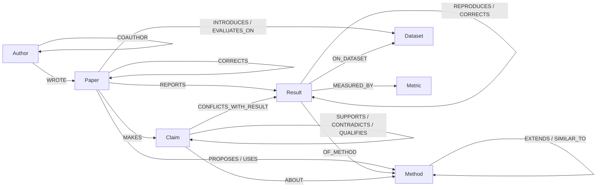
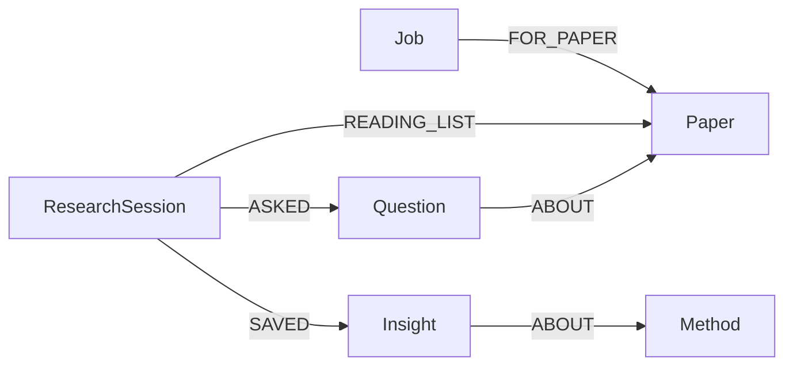

# GraphMind Research

Drop a folder of research papers in. Four agents read them and build a knowledge graph in FalkorDB: who cites whom
and why, which method extends which, every number from every results table, and what each paper claims. Then ask
how the papers relate, and get answers in which every sentence comes from a graph query you can open and check.

**Tracks:** Agents That Act on Connected Data · Agent Memory and Coordination
**Demo video:** DEMO_VIDEO_LINK
**Built for:** Graph Hacks (WeMakeDevs × FalkorDB), 15–18 October 2026


## What you can ask

| Question | What the graph does |
|---|---|
| How are GraphWalker-QA and Revisiting Graph Gains related? | Follows every path between the two papers: the citation and its intent, shared authors and datasets, method lineage, claims that clash, results one re-ran from the other |
| Is HopLens really state of the art? | Joins HopLens's "state of the art" claim to every earlier result on the same dataset, split and metric, and finds GraphFuse higher on two of them. It also finds two earlier papers HopLens should probably cite |
| What is the leaderboard on TriHop-Bench 4-hop? | One number per method. GraphFuse's 22.7 was corrected to 19.4 by an erratum, so 19.4 is the number that counts |
| Where does LiteGraphFuse come from? | Walks `EXTENDS` edges back to the original methods |
| Which claims contradict each other? | Claim pairs the graph picked (the newer paper cites the older, both are about the same method), judged by the local LLM |
| Which authors bridge the groups? | Betweenness centrality over co-authorship, computed inside FalkorDB |
| What did I save earlier? | Reads the session's Insight nodes back from the graph |

The same findings have their own pages in the web UI: Library, Ask, Compare papers, Leaderboards, Disagreements,
Citation check, Research gaps, People and Sessions.


## Why it needs a graph

FalkorDB is not a store behind a chat box here; every feature is a graph query.

- **Answers are graph queries.** The research agent picks named Cypher queries (its tools) for the question, turns
  each result row into a numbered fact, and writes the answer from those facts only. The LLM never writes Cypher,
  and an answer that names anything outside the facts is rejected.
- **Multi-hop by nature.** A state-of-the-art check goes Paper → Claim → its scope → Results on the same dataset, split
  and metric → other Papers, published earlier. A missing-citation check combines three path patterns (shared
  datasets, look-alike methods, stronger results). Lineage is a variable-length walk over `EXTENDS`.
- **Graph algorithms as tools.** PageRank over `CITES` (influential papers), betweenness over `COAUTHOR` (bridge
  authors), weakly connected components (isolated groups).
- **The graph is the agents' shared state.** The four pipeline agents never call each other: they claim `Job` nodes,
  write their results into the graph, and hand the job on. A `Lock` node guards the steps that rewrite the whole graph.
- **The graph is the memory.** Sessions, questions (with their full answers) and saved insights are nodes linked to
  the papers and methods they are about, so they survive restarts and can be recalled by topic.
- **One graph per workspace.** Each workspace is its own FalkorDB graph (`ws_<name>`), so users or teams keep
  separate libraries and memories.
- **No graph, no product.** Stop FalkorDB and every API route answers 503; the UI shows a banner and comes back by
  itself when FalkorDB returns.

## Architecture


**The graph decides, the LLM judges, the vector store explains.**

- *Build path:* every uploaded PDF passes four agents. **Parser** (rules, no LLM) creates papers, authors, citations
  with their sentences, and one `Result` per table cell, and indexes the text in ChromaDB. **Extractor** labels why
  each citation was made (graph rules first, cue words second) and has the LLM pick each paper's main claim from its
  own sentences. **Linker** merges different spellings of the same method and links look-alike methods
  (`SIMILAR_TO`, by embedding the method sections). **Critic** asks the LLM how claim pairs relate, but only for pairs
  the graph picked, and checks state-of-the-art claims against the numbers.
- *Ask path:* a LangGraph agent: understand → plan → run the graph queries → find the passage behind each fact in
  ChromaDB (only inside the papers the graph chose) → verify, with at most one more round → answer → remember.
- *Stack:* FalkorDB 6 (Docker), Python, FastAPI, LangGraph, ChromaDB, Ollama (llama3.2 and nomic-embed-text, both
  local), React with Vite, Tailwind and React Flow.

## Graph data model

The full schema, with every property, is in [`ontology.json`](ontology.json); direction conventions and counts on the
gold graph are in [`docs/DATA_MODEL.md`](docs/DATA_MODEL.md). The core:



Agent coordination and memory live in the same graph:



| Node | What it is |
|---|---|
| `Paper` | A paper. `in_library` is true when its PDF was uploaded, false for a stub created from someone's reference list |
| `Author`, `Institution`, `Venue` | People and where they publish; `COAUTHOR` is stored in both directions because betweenness follows edge direction |
| `Method`, `Dataset`, `Task`, `Metric` | Named things the papers talk about; `aliases` keeps every spelling, `anchors` the papers cited right next to a mention |
| `Result` | One number from one table cell: value, split, origin (proposed, baseline run, quoted, reproduced, corrected), setting |
| `Claim` | A paper's main finding, one sentence; state-of-the-art claims carry their scope so they can be checked against results |
| `Job`, `Lock` | Pipeline work items (stage, status, claimed_by, history) and the graph-wide mutex |
| `ResearchSession`, `Question`, `Insight` | Research memory: what was asked (with the full answer), and what the user decided to keep |

`CITES.intent` is one of: extends, compares_against, uses_dataset, uses_method, reproduces, supports, criticizes,
corrects, background.

## Cypher queries and graph algorithms

All 67 named queries are in [`docs/CYPHER.md`](docs/CYPHER.md), generated from the code
(`python -m app.graph.export_cypher`; `--check` fails if the file is out of date):

- **Agent tools** (`backend/app/graph/analysis.py`): paper-pair paths, lineage, leaderboards, claim conflicts,
  state-of-the-art check, missing and stale citations, research gaps, and the FalkorDB algorithms
  `algo.pageRank`, `algo.betweenness` and `algo.WCC`.
- **Citation facts** (`backend/app/agent/enrich.py`): what the graph can prove about why one paper cites another.
- **Agent coordination and memory** (`backend/app/agent/memory.py`): atomic job claim, hand-off, retries, the lock,
  sessions, insights, "what's new since".
- **UI views** (`backend/app/api/main.py`): the reads behind the web pages.

## The agents

**Pipeline agents (Agent Memory and Coordination).** Parser, Extractor, Linker and Critic run as separate threads and
coordinate only through FalkorDB:


- *Claim:* one write query finds a ready job for the agent's stage and marks it running. FalkorDB runs write queries
  one at a time per graph, so two agents can never claim the same job.
- *Waves:* a stage starts only when every paper has finished the stages before it, because citation intents and claim
  pairs depend on which papers exist.
- *Lock:* steps that rewrite the whole graph (ingest, merging names) take a `Lock` node first.
- *Failure:* a failed job goes back to ready and fails for good after three attempts; a job left running by a crashed
  process is put back when the agents next start. Each job keeps the history of which agent did which stage, which
  the UI shows live.

**Research agent (Agents That Act on Connected Data).** A LangGraph workflow. It recognises the question's intent and
the papers, methods and datasets it names; chooses a fixed plan of named graph queries for that intent; runs them;
attaches the supporting passage to each fact; checks whether anything the question needs is missing and runs more
queries if so (at most two rounds); and writes the answer from the facts. Unknown names get a clarifying question
instead of a guess. Every step is streamed to the UI with the Cypher it ran.

**Memory.** Each session's questions, answers and insights are stored as nodes linked `ABOUT` the papers and methods
they concern. The agent recalls them ("What did I save earlier about HopLens?"), and "What's new since" lists papers
added after a question that touch its topics.

## How well it works

Measured against a hand-built ground-truth graph (`ground_truth/gold_graph.json`) for the 12 papers in `corpus/`.
Numbers from `python -m app.eval_extraction` on the `agents` workspace (built by the four agents) and the `demo`
workspace (LLM intents); the deterministic Stage 2 scorecard and why each recall is below 1.0 are in
[`docs/EVALUATION.md`](docs/EVALUATION.md).

| What | Result |
|---|---|
| Citations found | 49 / 49 |
| Results extracted from tables | 70 / 70 |
| `EXTENDS` and `SIMILAR_TO` between methods | 4 / 4 and 1 / 1 |
| Citation intent accuracy | 0.918 with graph rules and cue words (LLM alone: 0.735; cue words alone: 0.551) |
| Claims (main finding per paper) | precision 0.364, recall 0.615 |
| Claim relations (SUPPORTS, CONTRADICTS, QUALIFIES) | 1 of 9 found; most predicted relations are wrong (precision under 0.07) |
| Four agents on all 12 PDFs | about three minutes on a laptop with Ollama, same graph as the step-by-step build |

The weakest part is claim extraction and claim relations, where a small local LLM decides; the design keeps the LLM
away from anything the graph can decide by itself.

## Setup (local)

Live deployment is not practical (it needs a local LLM), so this is the complete local setup. Developed on Windows;
the same commands work on macOS and Linux with `/` paths and `source .venv/bin/activate`.

**Prerequisites:** Docker, Python 3.12 or newer, Node.js 22 or newer, [Ollama](https://ollama.com).

1. **FalkorDB** (tested with 6.0.1), from the repo root:
   ```
   docker compose up -d
   ```
   This starts the container `falkordb` from `docker-compose.yml`, with its data in a Docker volume. Port 3000 is
   FalkorDB's own browser, if you want to look at the graph directly.
2. **Ollama models:**
   ```
   ollama pull llama3.2
   ollama pull nomic-embed-text
   ```
3. **Backend:**
   ```
   cd backend
   python -m venv .venv
   .venv\Scripts\activate
   pip install -r requirements.txt
   copy .env.example .env
   ```
   The defaults in `.env` point at FalkorDB on localhost:6379 and Ollama on localhost:11434.
   `python -m app.health` checks FalkorDB, Ollama and the ChromaDB path.
4. **Frontend:**
   ```
   cd ..rontend
   npm install
   ```

## Run

Two terminals:

```
:: 1. API (in backend\, venv active)
python -m uvicorn app.api.main:app --port 8000

:: 2. UI (in frontend\)
npm run dev
```

Open http://localhost:5173, create a workspace (the + next to the workspace name), and drop the PDFs from
`corpus\pdf` onto the Library page. The pipeline board shows the four agents at work (about three minutes with
Ollama); then try the questions above on the Ask page.

Everything also runs from the command line (in `backend\`):

```
:: build a workspace step by step: parse (no LLM) and index passages, then enrich
python -m app.graph.ingest --workspace demo --index ..\corpus\pdf
python -m app.agent.enrich --workspace demo

:: or let the four agents do it
python -m app.agent.pipeline --workspace agents --workers 2 ..\corpus\pdf

:: ask, with the passage behind each fact
python -m app.agent.workflow --workspace demo --evidence "Is HopLens really state of the art?"

:: score a workspace against the ground truth
python -m app.eval_extraction --workspace demo

:: oracle mode: load the hand-built ground-truth graph as workspace gold, and run one analysis query on it
:: (the analysis CLI takes the workspace name, not the graph name ws_gold)
python -m app.graph.gold_loader --workspace gold
python -m app.graph.analysis gold leaderboard dataset=ds-kaveri split=3-hop metric=metric-em

:: tests (need FalkorDB running) and the Cypher doc check
pytest -q
python -m app.graph.export_cypher --check
```

## Project layout

```
backend/
  app/graph/     pdf_parser.py (PDF -> text, references, tables), ingest.py (graph writes), analysis.py (agent tools),
                 client.py (one graph per workspace), export_cypher.py
  app/agent/     pipeline.py (four agents), enrich.py (intents, claims, links), memory.py (jobs, lock, sessions),
                 workflow.py (research agent), llm.py (Ollama calls with closed answer sets)
  app/docs/      docstore.py (ChromaDB passages)
  app/           config.py (settings from .env), health.py (service check), eval_extraction.py (scoring)
  app/api/       main.py (FastAPI; server-sent events for the agent)
  tests/
frontend/src/    pages/ (one per screen), components/ (map, pipeline board, step timeline, answers)
corpus/          12 synthetic papers: pdf/ and their source_md/
ground_truth/    gold_graph.json, expected_answers.json
ontology.json    node labels, relationship types, closed vocabularies
docs/            CYPHER.md, DATA_MODEL.md, EVALUATION.md, BUILD_GUIDE.md, architecture diagram, screenshots,
                 ai-assistance/
```

## Data

The 12 papers in `corpus/` are synthetic: written for this project, with invented methods, datasets and authors, so
that the correct graph is known and the extraction can be measured. No real, paywalled or personal data is loaded.

## Limitations

- The PDF parser is tuned to the corpus layout (numbered references, results tables with a source column); real
  papers with other layouts will yield fewer results and citations.
- Claim extraction and claim relations depend on a small local LLM and are the least accurate part.
- Runs locally; there is no hosted demo and no user accounts (workspaces are separate graphs, not access control).

## AI assistance

AI coding assistants were used, as the rules allow: Claude (Anthropic) for design and the step-by-step instructions,
and Claude Code to apply them in this repository. Every instruction file in order, is in
[`docs/ai-assistance/`](docs/ai-assistance/README.md).
