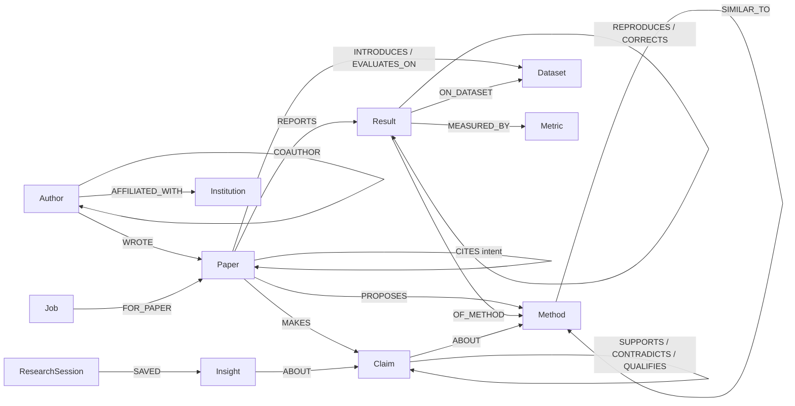

# GraphMind Research — Paper Relationship Agent
## Complete build guide for Graph Hacks (FalkorDB × WeMakeDevs), 15–18 October 2026

Upload a set of research papers as PDFs. GraphMind builds a knowledge graph in FalkorDB: who cites whom and why, which method extends which, which numbers can be compared, which claims support, contradict or narrow each other, which citations are missing or out of date, and where the open gaps are. An agent answers questions over that graph and shows the path and the passage behind every answer.

This file contains everything: the plan, the theory you will be asked about, the data model, the `CLAUDE.md` context file, ten phase prompts for Claude, and the reference code for every risky part. The reference code was run against FalkorDB with the included corpus, and all 22 tests pass (analysis, ingestion in three random upload orders, LLM plumbing).

---

## 0. How to use this guide

### 0.1 What is in the kit

```
graphmind-research-kit/
├── GRAPHMIND_RESEARCH_GUIDE.md      ← this file
├── ontology.json                    ← node labels, relationship types, closed vocabularies (intents, claim types, metrics)
├── corpus/
│   ├── pdf/          12 synthetic research papers (P01–P12), real PDFs with tables and reference lists
│   └── source_md/    the same papers as Markdown, for reading and debugging
└── ground_truth/
    ├── gold_graph.json        the graph a perfect extractor would build (141 nodes, 583 relationships)
    └── expected_answers.json  what the agent must answer: relationships, leaderboards, contradictions, gaps
```

All papers, authors, institutions, datasets and numbers are fictional (each PDF says so in its footer). Two real, well-known papers (Dense Passage Retrieval and HotpotQA) appear only as references, with correct metadata. That keeps you inside hackathon rule 6.

### 0.2 Workflow with Claude Code

1. Create a repo `graphmind-research/`. Copy `corpus/`, `ground_truth/` and `ontology.json` into it, and copy this guide to `docs/BUILD_GUIDE.md`.
2. Put Section 5 of this guide into `CLAUDE.md` at the repo root. Claude Code reads it at the start of every session.
3. Paste one phase prompt at a time (Section 6). Each prompt tells Claude which reference code to take from `docs/BUILD_GUIDE.md`, so you never copy code by hand.
4. After each phase: run the check, read the diff, and ask Claude *"Explain this phase as if a judge is going to question me on it."* Rule 12 requires you to explain the graph model, queries and architecture.
5. Commit after each phase.

### 0.3 Which tracks to enter

| Track | Fit | Why |
|---|---|---|
| **01 Agents That Act on Connected Data** | **Strong — primary** | Multi-hop reasoning (method lineage, claim chains), graph queries and FalkorDB algorithms as agent tools, explainable paths, actions (flag stale citations, build reading lists, draft reviews). |
| **02 Agent Memory and Coordination** | **Good — if you finish Phases 5 and 6** | Four pipeline agents hand work to each other through Job nodes in the graph; research sessions and saved insights persist; one graph per workspace keeps users separate. |
| 03 Company Brain | Weak | That track is about how a company works (people, teams, projects, decisions). Do not enter it with this idea. |

### 0.4 Schedule (window closes Sunday 18 Oct, 11:59 PM IST)

| When | Phases | You can show by the end |
|---|---|---|
| Thu 15 evening | 0, 1 | Gold graph in FalkorDB; all analysis questions answered correctly (oracle mode) |
| Fri 16 | 2, 3, 4 | Upload PDFs → graph built without LLM; passages in ChromaDB; LLM adds intents, claims, claim relations; scorecard |
| Sat 17 | 5, 6, 7 | Agents coordinating through the graph; research agent answering with evidence; API with live progress |
| Sun 18 | 8, 9 | UI, README, demo video, submit before 10 PM |

**Minimum viable demo if you fall behind:** Phases 0–4 + a simple UI (upload, library graph, ask box with evidence). Run the four pipeline stages in one background task instead of separate agents, and drop Track 02.

---

## 1. The idea

### 1.1 Problem statements (replacing the company version)

**Problem 1 — Understanding how papers relate.** A researcher with 12 PDFs cannot see at a glance which paper builds on which, which ones evaluate on the same dataset, or that two papers share an author. Reference lists are flat; the relationships are hidden in sentences like "GraphFuse extends GraphWalker-QA [2] and HopRank [3]".

**Problem 2 — Comparing evidence across papers.** Every paper prints its own results table, quotes other papers' numbers, re-runs baselines with slightly different results, and sometimes publishes an erratum. Nobody keeps one corrected leaderboard.

**Problem 3 — Trustworthy answers.** A chatbot that summarises PDFs repeats each paper's claims. It does not notice that a 2024 reproduction contradicts a 2022 claim, that a Tamil benchmark narrows an English result, or that a "state of the art" claim is beaten by a paper the authors never cited.

**Problem 4 — Turning a library into research work.** The useful output is not a summary but actions: citations to add, numbers to update, gaps worth a thesis, a reading order, and insights saved for the next session.

### 1.2 What GraphMind Research does (and what a normal RAG bot cannot)

| Question | RAG chatbot | GraphMind Research (from the graph) |
|---|---|---|
| How are *GraphWalker-QA* and *Revisiting Graph Gains* related? | Summarises both | P08 **reproduces** P03; shares author Jonas Weber; 4 reproduced numbers (39.8 → 35.1 with predicted links); claim C08 **contradicts** C03 |
| Who is best on KaveriHop 3-hop? | Quotes whichever paper it retrieved | One leaderboard from 70 extracted results; quoted numbers deduplicated; reproductions shown as spread |
| Is HopLens really state of the art? | "Yes, the paper says so" | No: GraphFuse (P06) is higher on both splits; P12 never cites P06 or the similar HopRank (P04) |
| What is the 4-hop TriHop score of GraphFuse? | 22.7 | 19.4 — corrected by an erratum (P09); P10 still quotes the old number |
| What should someone work on next? | Generic advice | Entity linking for Tamil: 3 claims blame it, no paper in the library proposes a method for it |

---

## 2. Theory you must be able to explain

### 2.1 Why a graph and not just RAG

The relationships that matter are *between* documents and *across* several hops: *P10 extends P06, which extends P03 and P04, and P04 extends P01* is a four-hop chain no single passage states. "Which results can be compared?" needs `Result → OF_METHOD → Method`, `Result → ON_DATASET → Dataset` and `Result → MEASURED_BY → Metric` joined across 12 papers. Vector search retrieves passages similar to a question; the graph follows typed connections.

### 2.2 The graph does entity resolution (citation anchors)

The same method is written `GraphWalker-QA`, `GraphWalker` and `GW-QA`; the same dataset `KaveriHop` and `Kaveri-Hop`, `TriHop-Bench` and `TriHop`. String similarity cannot tell that `GW-QA` is `GraphWalker-QA`. The graph can:

```
P05 text:  "We evaluate DenseHop [2], GW-QA [3] and HopRank [4]"
           reference [3]  ──resolves to──▶  Paper P03  ──PROPOSES──▶  GraphWalker-QA
           therefore GW-QA = GraphWalker-QA
```

A mention followed by a citation is *anchored* to the cited paper; if that paper proposes a method, the mention is that method. This is deterministic, needs no LLM, and is a strong example of "the graph does real work".

### 2.3 Upload order must not matter

Users upload papers in any order. If P12 arrives before P03, P12's reference to P03 creates a **stub** `Paper {in_library: false}`. When P03 is uploaded later it **adopts** the stub (same node), so earlier citations already point at it. A `reconcile` step runs after every upload and merges methods/datasets whose identity only becomes clear later. Tested: four random upload orders all produce exactly the gold citations, results, methods and datasets.

### 2.4 The graph decides, the LLM judges, the vector store explains

| Job | Who does it | Why |
|---|---|---|
| Papers, authors, references, tables, method/dataset identity, reproductions, errata, lineage | Parser + graph rules | Deterministic, testable, 100% on the corpus |
| Why a paper cites another (intent), which sentences are claims, how two claims relate | `llama3.2`, closed JSON schema, temperature 0 | Short classification and copying a sentence — what a 3B model does well |
| Which claim pairs are worth judging | The graph (claims about the same method, newer → older) | 38 pairs instead of 78; all 9 true relations are among them |
| The passage that proves a relationship | ChromaDB, filtered to the papers the graph points at | Graph-guided retrieval: right paper first, then right paragraph |

Keyword rules get only 55% of citation intents right (measured on this corpus), which is why intent is the LLM's job. Every LLM output is validated: an extracted claim must be a sentence that actually appears in the paper; entities must already exist in the graph; an answer that names an entity not in its facts is rejected.

### 2.5 Facts, checks and open questions

- **Facts** come from paths in the graph (`P10 -CITES {extends}-> P06`).
- **Checks** are computed from numbers, not from the text: `sota_check` compares a "state of the art" claim with every earlier result in its scope; the leaderboard replaces a number with its erratum correction.
- **Open questions** are explicit: a result whose `setting` is "not reported", a claim pair the LLM marked `UNRELATED`, a method only proposed outside the library.

### 2.6 Shared state between agents lives in the graph

Four agents — **Parser, Extractor, Linker, Critic** — each claim `Job` nodes of their stage, do their work, and hand the job to the next stage. FalkorDB executes write queries one at a time per graph, so the claim query cannot hand the same job to two agents. Tested with 8 agents racing over 12 jobs: every job passed through all four stages exactly once, and a simulated failure was retried. The UI's pipeline board is just a query over `Job` nodes.

### 2.7 Memory: episodic and semantic

- **Semantic memory** is the library graph itself; it grows with every upload.
- **Episodic memory** is `ResearchSession → ASKED → Question → ABOUT → (Paper|Method|Claim)` and `ResearchSession → SAVED → Insight`. "What did I conclude about GraphWalker-QA?" and "What is new since my last session?" are graph queries.
- **Separation per user/team:** one FalkorDB graph per workspace (`ws_<name>`) and one ChromaDB collection per workspace (tested).

### 2.8 Graph algorithms that earn their place

- **PageRank over `CITES`** → most influential papers, including ones not in your library (DenseHop P01 first; NarmadaQA's paper second).
- **Betweenness over `COAUTHOR`** → authors who connect groups (Ananya Iyer, Lena Fischer). FalkorDB's betweenness is sampled; pass `samplingSize` and a fixed `samplingSeed` so results are reproducible, and present it as a ranking.
- **WCC over `COAUTHOR`** → the HopLens authors form an isolated group, which is a plausible reason P12 missed P04 and P06.

### 2.9 The "remove FalkorDB" test (rule 3)

Everything the product shows — library map, leaderboards, contradictions, citation checks, gaps, agent answers, pipeline board, memory — is a Cypher query. PDFs are read only by the parser, which writes to the graph. If FalkorDB is down, uploads and questions fail with HTTP 503. Show this in the video.

---

## 3. Graph data model

### 3.1 Node labels

| Label | In corpus | Key properties |
|---|---|---|
| Paper | 12 library + 4 stubs | title, year, published, in_library, abstract, keywords, file, first_author, added_at |
| Author | 13 | name |
| Institution | 7 | name |
| Venue | 4 | name, short |
| Method | 8 | name, aliases[], keys[] (normalised spellings), anchors[] (papers cited next to a mention), family |
| Dataset | 4 | name, aliases[], keys[], anchors[], language, splits[] |
| Task / Metric | 3 / 3 | name, aliases; metric has unit, higher_is_better |
| Result | 70 | value, split, origin (proposed, baseline_run, quoted, reproduced, corrected), setting, source, reported_as |
| Claim | 13 | text, type (comparative, causal, sota, efficiency, observational), section, scope[] for sota |
| Job | runtime | stage, status, claimed_by, attempts, history[], error |
| ResearchSession / Question / Insight | runtime | memory |

### 3.2 Relationships

| Relationship | Meaning |
|---|---|
| `(Author)-[:WROTE {position, affiliation}]->(Paper)` | authorship, with the affiliation printed in that paper |
| `(Author)-[:AFFILIATED_WITH {first_year, last_year}]->(Institution)` | career history (Rahul Mehta moved in 2024) |
| `(Author)-[:COAUTHOR {papers, count}]->(Author)` | stored once, smaller id first |
| `(Paper)-[:PUBLISHED_IN]->(Venue)` | |
| `(Paper)-[:CITES {intent, ref_no, contexts}]->(Paper)` | **contexts** = the sentences where the citation appears |
| `(Paper)-[:PROPOSES]->(Method)`, `(Paper)-[:INTRODUCES]->(Dataset)` | contributions |
| `(Paper)-[:EVALUATES_ON]->(Dataset)`, `(Paper)-[:USES]->(Method)` | experiments, baselines, tools |
| `(Method)-[:EXTENDS]->(Method)` | derived: proposing paper cites the other with intent `extends` |
| `(Method)-[:SIMILAR_TO {score, basis}]->(Method)` | method sections embed close, but no lineage and no citation |
| `(Paper)-[:REPORTS]->(Result)-[:OF_METHOD\|ON_DATASET\|MEASURED_BY]->(…)` | one table cell |
| `(Result)-[:QUOTED_FROM]->(Paper)` | number copied from another paper |
| `(Result)-[:REPRODUCES {setting}]->(Result)`, `(Result)-[:CORRECTS]->(Result)`, `(Paper)-[:CORRECTS]->(Paper)` | reproductions and errata |
| `(Paper)-[:MAKES]->(Claim)-[:ABOUT]->(Method\|Dataset)` | findings |
| `(Claim)-[:SUPPORTS\|CONTRADICTS\|QUALIFIES {basis}]->(Claim)` | newer → older |
| `(Claim)-[:CONFLICTS_WITH_RESULT {basis}]->(Result)` | claim beaten by a number |
| `(Job)-[:FOR_PAPER]->(Paper)` | pipeline state shared by agents |
| `(ResearchSession)-[:ASKED]->(Question)-[:ABOUT]->(…)`, `(ResearchSession)-[:SAVED]->(Insight)-[:ABOUT]->(…)`, `(ResearchSession)-[:READING_LIST]->(Paper)` | memory |



### 3.3 Why `Result` is a node, not a property

A number has its own relationships: which method, which dataset, which metric, which paper reported it, which paper it was copied from, which result it reproduces or corrects. As a node it can be joined across papers (leaderboards), linked to corrections, and conflicted with claims. As a property on a paper, none of that is possible.

---

## 4. The dataset: what is planted and what the agent must find

The corpus is a small fictional research field: multi-hop question answering with dense, graph-based and hybrid retrieval, 2021–2026. Ground truth is in `ground_truth/expected_answers.json`; the tests in Reference D check every item.

| # | Paper | Year | Role in the story |
|---|---|---|---|
| P01 | DenseHop | 2021 | Root method; most influential by PageRank |
| P02 | KaveriHop benchmark | 2022 | Introduces the main dataset; says gold entity annotations must not be used at test time |
| P03 | GraphWalker-QA | 2022 | Graph method; quietly uses the gold annotations; claims bigger gains on 3-hop |
| P04 | HopRank | 2023 | Extends DenseHop; calls its component "hop-aware re-scoring" (alias) |
| P05 | TriHop-Bench | 2023 | 3–4 hop benchmark; writes `GW-QA` (alias resolved by citation anchor) |
| P06 | GraphFuse | 2024 | Extends GraphWalker-QA and HopRank; best results |
| P07 | VaigaiQA (Tamil) | 2024 | Graph retrieval worse than dense in Tamil — **qualifies** P03/P05 |
| P08 | Reproduction study | 2024 | **Reproduces** P03; with predicted links the gain vanishes — **contradicts** P03; shares author with P03 |
| P09 | Erratum to GraphFuse | 2025 | **Corrects** 4-hop 22.7 → 19.4 |
| P10 | LiteGraphFuse | 2025 | Extends GraphFuse; still quotes 22.7 — **stale citation**; efficiency claim that checks out numerically |
| P11 | Entity-linking error analysis | 2025 | **Supports** P07 and P08: one root cause |
| P12 | HopLens | 2026 | Claims state of the art — **false** (GraphFuse higher); never cites the similar HopRank or GraphFuse — **missing citations**; isolated author group |

Additional traps: reference titles written differently (P10's "VaigaiQA: multi-hop QA in Tamil", P11's shortened P08 title) must resolve to the library paper; the erratum's title contains GraphFuse's full title but must not be merged with it; DenseHop on KaveriHop 3-hop is reported as 31.5 (P02) and 31.9 (P03 re-run) — the leaderboard shows the spread instead of hiding it.

**Demo questions that work on this corpus:**
1. How are *GraphWalker-QA* and *Revisiting Graph Gains* related?
2. Trace the lineage of LiteGraphFuse.
3. Show the leaderboard for KaveriHop 3-hop exact match. Now TriHop-Bench 4-hop.
4. Is HopLens really state of the art?
5. Where do these papers disagree?
6. Which citations are missing or out of date?
7. What are the research gaps?
8. Who are the bridge authors, and who is isolated?
9. (Next session) What did I conclude about GraphWalker-QA? What is new since then?

To show "what's new", upload P01–P10 and P12 first, ask question 1, save an insight, then upload P11 and ask question 9.

### Bring your own papers

The pipeline is built for this corpus and generalises to clean single-column PDFs. For real papers: use open-access ones you are allowed to use (arXiv with a CC-BY licence is safest — rule 6), expect the header and reference parser to miss fields, and let the LLM fallback fill title/authors from the first page. For serious real-world use, GROBID (a Docker image for scientific PDF parsing) is the standard tool; mention it as future work rather than adding it during the hackathon.

---

## 5. `CLAUDE.md` — paste into the repo root

````markdown
# GraphMind Research — project context for Claude

## What we are building
A research-paper relationship agent. Users upload PDFs; we build a knowledge graph in FalkorDB
(papers, authors, citations with intent, methods, datasets, results, claims and how claims relate),
store passages in ChromaDB, and answer questions with graph paths plus source passages. Pipeline
agents coordinate through Job nodes in the graph; research sessions and insights are saved as memory.
Hackathon: Graph Hacks (WeMakeDevs × FalkorDB), 15–18 Oct 2026. Tracks: Agents That Act on Connected
Data; Agent Memory and Coordination.

## Non-negotiable rules
1. FalkorDB is the source of truth. PDFs are read only by backend/app/graph/pdf_parser.py, whose
   output is written to the graph by ingest.py. Every API answer comes from Cypher. If FalkorDB is
   unreachable, return HTTP 503 — never fall back to files or memory.
2. All Cypher lives in named, parameterised queries (Q dicts in analysis.py and memory.py, plus
   ingest.py). Never format user input into Cypher. The LLM never writes Cypher.
3. The LLM (Ollama llama3.2) is used only in backend/app/agent/llm.py: citation intent, claim
   extraction, claim-pair relation, and the final short answer. Closed JSON schemas, temperature 0,
   validated outputs, deterministic fallbacks.
4. Direction conventions: (newer Claim)-[:SUPPORTS|CONTRADICTS|QUALIFIES]->(older Claim);
   (Method)-[:EXTENDS]->(parent Method); (Result)-[:REPRODUCES|CORRECTS]->(original Result).
5. Upload order must not change the final graph. reconcile() runs after every upload.
6. Each workspace = one FalkorDB graph "ws_<name>" + one ChromaDB collection "papers_<name>".
7. Data is synthetic (corpus/) or open-access papers the user is allowed to use.

## Stack
Python 3.11+, FastAPI, LangGraph >= 1.0, falkordb (Python client), chromadb >= 1.0 (PersistentClient),
pymupdf, rapidfuzz, httpx, pydantic v2, sse-starlette, pytest. FalkorDB in Docker on 6379 (browser 3000).
Ollama at localhost:11434 with llama3.2:latest and nomic-embed-text. Frontend: React + Vite + TypeScript,
Tailwind v4 (@tailwindcss/vite), @xyflow/react with @dagrejs/dagre, lucide-react.

## Repo layout
backend/app/graph/   client.py, gold_loader.py, analysis.py, pdf_parser.py, ingest.py
backend/app/docs/    docstore.py
backend/app/agent/   llm.py, memory.py, enrich.py, pipeline.py (agents), workflow.py (research agent)
backend/app/api/     main.py, schemas.py
backend/app/eval_extraction.py
backend/tests/       test_analysis.py, test_ingest.py, test_enrich.py, test_pipeline.py, test_agent.py, test_api.py
frontend/src/        pages and components
corpus/ ground_truth/ ontology.json docs/

## Ground truth
ground_truth/gold_graph.json (oracle mode and scoring) and ground_truth/expected_answers.json.
Tests must pass before moving to the next phase.

## How to work with me
I am an AI/ML trainer and must explain every part to judges. After each task explain what you built,
WHY it is built that way (with the theory), and how to verify it. Work in small steps, run tests after
each change, show the commands you ran. Ask before adding dependencies. If the data looks wrong, tell me.
````

**Why these rules:** 1–2 make the graph central (hackathon rule 3) and keep queries safe; 3 is the small-LLM design from §2.4; 4 prevents direction bugs that silently invert meaning; 5 is what makes uploads reliable; 6 gives Track 02 its "separate memory per user"; the last section makes Claude teach you as it builds.

---

## 6. Phase prompts

Paste each block into Claude Code. Below each block: why the phase exists and how to check it.

---

### Phase 0 — Scaffold, environment, health check

```text
Read CLAUDE.md. Scaffolding only, no features.

1. Create the repo layout from CLAUDE.md. Keep corpus/, ground_truth/, ontology.json, docs/ as they are.
2. backend/requirements.txt: falkordb, chromadb>=1.0, langgraph>=1.0, fastapi, uvicorn[standard],
   sse-starlette, python-multipart, pymupdf, rapidfuzz, httpx, pydantic>=2, python-dotenv, pytest.
   backend/.env.example: FALKORDB_HOST=localhost, FALKORDB_PORT=6379, DEFAULT_WORKSPACE=demo,
   OLLAMA_URL=http://localhost:11434, LLM_MODEL=llama3.2:latest, EMBED_MODEL=nomic-embed-text,
   CHROMA_PATH=./chroma_data, SQLITE_PATH=./graphmind.db, UPLOAD_DIR=./uploads.
3. docker-compose.yml with service "falkordb": image falkordb/falkordb:latest, ports 6379 and 3000,
   named volume falkordb_data at /var/lib/falkordb/data. I already have a FalkorDB container: run
   `docker ps`, tell me its name/ports/volumes, and if it has no volume explain why memory across
   sessions needs one and give me the commands to recreate it with the volume.
4. backend/app/graph/client.py: get_db() singleton and graph_for(workspace) -> db.select_graph(f"ws_{workspace}").
   Validate workspace names with ^[a-z0-9_]{1,32}$ (they become graph names).
5. backend/app/health.py: check_all() -> {falkordb, ollama (llama3.2 and nomic-embed-text present),
   chroma (path writable)}; `python -m app.health` exits non-zero on failure.
6. frontend/: Vite + React + TS, Tailwind v4 via @tailwindcss/vite, @xyflow/react, @dagrejs/dagre,
   lucide-react, react-router-dom; proxy /api to http://localhost:8000; placeholder page.
7. README stub with run commands; .gitignore (venv, node_modules, chroma_data, uploads, *.db, .env).

Explain the folder layout and why each workspace gets its own graph.
```

**Why:** a health check saves hours of "the agent is broken" that is really "Ollama is not running". Workspace-per-graph is the simplest strong isolation FalkorDB offers.

**Check:** `python -m app.health` all green; `npm run dev` shows the placeholder.

---

### Phase 1 — Oracle mode: analysis queries on the gold graph

```text
Build the analysis layer first, on perfect data, so later extraction bugs cannot hide analysis bugs.

1. backend/app/graph/gold_loader.py: EXACTLY "Reference A" in docs/BUILD_GUIDE.md.
2. backend/app/graph/analysis.py: EXACTLY "Reference B". Keep every query text unchanged.
3. backend/tests/test_analysis.py: EXACTLY "Reference C". Make it pass (it loads the gold graph into a
   separate graph named research_gold_test).
4. CLI: `python -m app.graph.gold_loader --workspace gold` loads the gold graph into ws_gold;
   `python -m app.graph.analysis ws_gold <query_name> key=value ...` prints rows as JSON.
5. docs/CYPHER.md generated from the Q dict (query name, the comment above it, the Cypher), with a
   script `python -m app.graph.export_cypher`.
6. docs/DATA_MODEL.md from Section 3 of the guide.

Explain, query by query: what pattern it matches, why the direction is what it is, and what the result
means for a researcher. Explain why Result is a node and how the leaderboard picks the authoritative value.
```

**Why:** this is the "brain" of the product. Proving it on gold data first means the demo questions already work by Thursday night, and every later phase only has to produce the same graph from PDFs.

**Check:** `pytest tests/test_analysis.py -v` → 14 passed. In the FalkorDB Browser: `MATCH p=(:Method {name:'LiteGraphFuse'})-[:EXTENDS*]->(:Method) RETURN p`.

---

### Phase 2 — PDF → graph without any LLM

```text
Implement deterministic ingestion.

1. backend/app/graph/pdf_parser.py: EXACTLY "Reference D".
2. backend/app/graph/ingest.py: EXACTLY "Reference E".
3. backend/app/eval_extraction.py: EXACTLY "Reference F".
4. backend/tests/test_ingest.py: EXACTLY "Reference G". It ingests the 12 PDFs in three random orders
   and checks the result against the gold graph.
5. CLI: `python -m app.graph.ingest --workspace demo corpus/pdf/*.pdf` and
   `python -m app.eval_extraction --graph ws_demo` (prints the scorecard).

Then explain:
- how the parser finds title, authors, sections, tables, references and citation sentences;
- same_paper(): why it uses year + first author + two different fuzzy scores, and how it avoids merging
  "Erratum: GraphFuse: ..." with "GraphFuse: ...";
- stubs and adoption, and why upload order does not matter;
- citation anchors ("GW-QA [3]") and how reconcile() merges methods and datasets;
- how REPRODUCES, CORRECTS and EXTENDS are derived.
```

**Why:** this is where "finding relationships between documents" actually happens, and it is all graph logic. The scorecard gives you measured numbers for the README.

**Check:** `pytest tests/test_ingest.py -v` → 4 passed. Scorecard after a plain ingest: CITES 49/49, Result 70/70, CORRECTS 1/1; claims and claim relations at 0 (that is Phase 4's job).

---

### Phase 3 — Passages in ChromaDB, graph-guided evidence, method similarity

```text
1. backend/app/docs/docstore.py: EXACTLY "Reference H". One collection per workspace (papers_<ws>).
   Chunk metadata paper_id must equal the FalkorDB Paper id.
2. Extend ingest so that after a PDF is written to the graph, its abstract and sections are added to
   the DocStore (re-upload replaces old chunks).
3. backend/app/docs/evidence.py:
   - evidence_for_edge(rel, src, dst): for CITES use the stored contexts first; for claims use the
     claim text; then call DocStore.evidence(text, [paper ids the graph points at], k=2).
   - Never return a passage from a paper the graph did not point to, unless the caller asks for open search.
4. Method similarity: run the unlinked_method_pairs query; for each pair compute cosine similarity of
   DocStore.section_vector(paper, "Method"); if >= 0.80 (tune: print all scores and tell me), MERGE
   (a)-[:SIMILAR_TO {score, basis: 'method-section embedding', detected_by: 'nomic-embed-text'}]->(b).
   Expected on the corpus: HopLens ~ HopRank is the highest unlinked pair.
5. Test (skips if Ollama is down): evidence for "GraphWalker-QA took its entity links from the dataset
   annotations" restricted to [P08, P03] returns a passage from P08 or P03 first.

Explain graph-guided retrieval, the nomic task prefixes, and why only UNLINKED method pairs are compared.
```

**Why:** Problem 3 needs a sentence behind every edge. Restricting retrieval to papers the graph selected makes the evidence precise. Similarity only between unlinked methods is what turns "these look alike" into "possible uncredited prior work".

**Check:** in a stand-in test, P04–P12 had the highest similarity among unlinked pairs (P06–P10 scored higher but is excluded because GraphFuse→LiteGraphFuse lineage already explains it).

---

### Phase 4 — LLM enrichment: intents, claims, claim relations

```text
1. backend/app/agent/llm.py: EXACTLY "Reference I".
2. backend/app/agent/enrich.py:
   a. classify_citations(graph, paper_id): for each outgoing CITES with intent 'unclassified', call
      classify_intent(citing title, cited title, contexts, fallback=keyword_intent); store intent and
      intent_source ('llm' or 'keywords'). Then call reconcile() so EXTENDS edges appear.
   b. extract_claims(graph, paper_id): known entities = names and aliases of all Method and Dataset
      nodes; text = abstract + the last section (conclusion/discussion/limitations). Create
      (Paper)-[:MAKES]->(Claim {id, text, type, section, scope}) and ABOUT edges to the resolved entities
      (resolve each 'about' name through keys, exactly like ingest.resolve_entity but without creating).
      For sota claims convert scope items 'KaveriHop|3-hop|EM' to '<dataset id>|<split>|<metric id>'.
   c. relate_claims(graph, paper_id): run claim_pair_candidates restricted to pairs involving this
      paper; for each pair fetch one evidence passage per claim, call judge_claims(newer, older), and
      MERGE the relation edge with basis unless the answer is UNRELATED.
   d. check_claims(graph): run sota_check and MERGE (claim)-[:CONFLICTS_WITH_RESULT {basis}]->(result).
3. Tests (tests/test_enrich.py) with Ollama mocked by a fake HTTP server (as in Reference I's test):
   invented claim sentences are dropped, unknown entities are dropped, fallback works when Ollama is down,
   EXTENDS appears after intents are set.
4. Run the full pipeline on the corpus with the real llama3.2 and print the scorecard. Put the
   scorecard in docs/EVALUATION.md with the keyword-baseline intent accuracy (0.551) next to the LLM's.

Explain why each LLM task is small and closed, how the outputs are validated, and how the graph
reduces 78 possible claim pairs to 38 candidates.
```

**Why:** these are the three things only language understanding can do. The scorecard turns "it seems to work" into a measured claim judges respect.

**Check:** scorecard shows CITES.intent_accuracy above the 0.551 keyword baseline, Claim recall > 0, and at least the CONTRADICTS edge C08 → C03. If llama3.2 is weak on intents, add 2–3 examples to the system prompt — do not add schema fields.

---

### Phase 5 — Pipeline agents that coordinate through the graph

```text
Implement backend/app/agent/memory.py from "Reference J" and backend/app/agent/pipeline.py:

1. Four agent classes — ParserAgent (stage 'parse'), ExtractorAgent ('extract'), LinkerAgent ('link'),
   CriticAgent ('critique'). Each runs a loop: job_claim for its stage; do its work; job_advance to the
   next stage; on exception job_fail (retry up to 3 attempts).
   - Parser: parse PDF, upsert paper/authors/references/tables (ingest functions), job_link_paper, add to DocStore.
   - Extractor: classify_citations + extract_claims for the job's paper.
   - Linker: reconcile(), method similarity for pairs involving this paper.
   - Critic: relate_claims for this paper, check_claims, and recompute stale/missing citations.
2. Start N workers per stage as asyncio tasks (run blocking calls with asyncio.to_thread) when the API
   starts; configurable WORKERS_PER_STAGE (default 1; demo with 2).
3. POST /api/workspaces/{ws}/papers (multipart, many files): save files, create one Job per file, return job ids.
4. tests/test_pipeline.py: 12 jobs, 2 agents per stage, fake LLM; assert every job reaches 'done',
   no job is claimed by two agents at once, and a forced failure is retried.

Explain why the job claim is safe without locks (FalkorDB serialises writes per graph), what "shared
state between agents" means here, and how the UI pipeline board is just the job_board query.
```

**Why:** Track 02 asks for shared state and hand-offs between agents. Here the hand-off is literally a property change on a graph node every agent can see.

**Check:** upload the 12 PDFs; the job board shows jobs moving parse → extract → link → critique → done, with `history` listing which agent did each stage.

---

### Phase 6 — The research agent (LangGraph)

```text
Build backend/app/agent/workflow.py from the skeleton in "Reference K".

State, nodes and routing as in the skeleton. Implement:
- understand: llm intent classification over the PLAN_TEMPLATES keys (closed enum; keyword fallback),
  then entity resolution with rapidfuzz over all Paper titles, Method/Dataset names+aliases and
  Author names fetched from the workspace graph (score >= 80; two candidates within 5 points ->
  clarify with the choices).
- plan: PLAN_TEMPLATES[intent] with parameters filled from the resolved entities. Emit the plan as an event.
- run_tools: run each query via Analysis.run; record query name, params, row count, ms and Cypher in a
  tool_log event (the UI shows it).
- gather_evidence: for the top facts, evidence_for_edge(...) from Phase 3.
- verify: turn rows into numbered facts (each with graph path node ids and paper ids). Gaps = empty
  results for a required query, a result with setting 'not reported', or entities not found. One
  extra round is allowed to run a fallback query (e.g. relate_papers with no citation -> also run
  missing_citations for the newer paper).
- answer: write_answer(question, facts) from llm.py; if it returns "" use a template answer built from
  the facts. The answer always ends with the facts list and their evidence.
- remember: question_log with ABOUT edges to the resolved entities; SQLite row with the full JSON.
Also: save_insight(session, text, about_ids) and add_to_reading_list(session, paper, reason).

Tests: with LLM mocked, each demo question in Section 4 of the guide returns facts matching
ground_truth/expected_answers.json (run on the gold workspace).

Explain why tools come from fixed plan templates, how the loop stops, and how the answer is checked.
```

**Why:** this is the agent judges will talk to. Fixed plans over tested queries make it reliable with a 3B model; the facts list makes every sentence traceable.

**Check:** `python -m app.agent.run --workspace gold "Is HopLens really state of the art?"` answers *no*, cites GraphFuse 46.3 and 41.2 from P06, and mentions the missing citations.

---

### Phase 7 — API

```text
backend/app/api/main.py (FastAPI). Every route checks FalkorDB first and returns 503 if it is down.

Workspaces:  GET /api/workspaces (graphs named ws_*), POST /api/workspaces {name}
Papers:      POST /api/workspaces/{ws}/papers (upload), GET /api/workspaces/{ws}/papers,
             GET /api/workspaces/{ws}/papers/{id} (metadata, sections, outgoing/incoming citations with intent)
Pipeline:    GET /api/workspaces/{ws}/jobs (job_board), GET /api/workspaces/{ws}/jobs/stream (SSE every second)
Graph views: GET .../graph/library (papers + CITES with intent), GET .../graph/node/{id} (neighbourhood),
             GET .../graph/lineage/{method_id}, GET .../graph/pair?a=&b= (Analysis.relationship)
Analysis:    GET .../leaderboard?dataset=&split=&metric=, GET .../claims/conflicts, GET .../claims/sota,
             GET .../citations/missing?paper=, GET .../citations/stale, GET .../gaps, GET .../people
Agent:       POST .../sessions, POST .../sessions/{sid}/ask {question} -> SSE stream of workflow events,
             POST .../sessions/{sid}/insights, GET .../sessions/{sid}/whats-new
Eval:        GET .../eval (scorecard; only meaningful for the synthetic corpus)
Health:      GET /api/health

tests/test_api.py: health, upload two PDFs and wait for jobs to finish, ask a question, 503 when FalkorDB
is unreachable. Explain SSE and why streaming workflow steps matters for the demo.
```

---

### Phase 8 — React workspace

```text
Read the frontend-design guidance if available. Professional research tool: neutral background, one
accent colour, clear type scale, no gradients or emoji.

Layout: left sidebar (workspace switcher, Library, Ask, Leaderboards, Disagreements, Citation check,
Gaps, People, Sessions, health dot). Pages:

1. Library — drag-and-drop upload; pipeline board (one row per paper, four stage pills, agent name on the
   active stage, errors in red); paper list with year, authors, in/out citation counts.
2. Library map — React Flow: papers as nodes laid out by year left->right (dagre, rankdir LR), CITES edges
   coloured by intent (legend), stub papers dashed. Click a paper -> side panel with its claims,
   results table, citations with the context sentence.
3. Ask — chat with live step timeline (plan, each query with expandable Cypher, evidence), answer with
   numbered facts; each fact shows its graph path as small breadcrumbs and its passage(s). Buttons:
   "Save as insight", "Add to reading list". Example chips with the demo questions.
4. Compare two papers — two pickers -> Analysis.relationship rendered as sections (citations,
   shared authors/datasets/methods, lineage, claim relations, reproductions, quoted numbers).
5. Leaderboards — dataset/split/metric pickers; table with method, value, paper, and badges:
   "corrected (was 22.7)", "reproduced 35.1–39.5", "spread 4.7".
6. Disagreements — CONTRADICTS / QUALIFIES / SUPPORTS cards with both claims, both papers, basis and
   evidence; sota-check failures in their own section.
7. Citation check — missing (score and reasons), stale (with the corrected value), external hubs to add.
8. Gaps — method x dataset matrix (empty cells highlighted), metric coverage, unreproduced methods,
   bottleneck task.
9. People — PageRank papers, bridge authors (betweenness), groups (WCC) as a small React Flow graph,
   affiliation history.
10. Sessions — past questions, saved insights, reading list, "What's new since" button.

Every graph view draws only nodes/edges returned by the API. Loading and empty states everywhere.
```

**Why:** the judges' first impression. The pipeline board shows coordination; the map shows the library as a graph; every analysis page is one Cypher query they can inspect.

---

### Phase 9 — Submission

```text
1. README.md: pitch; tracks entered (Agents That Act on Connected Data; Agent Memory and Coordination);
   architecture diagram (mermaid); graph data model (link docs/DATA_MODEL.md + relationship table);
   "Why FalkorDB is central" (every feature is a query; 503 without it; entity resolution by citation
   anchors; agents coordinate through Job nodes); the Cypher (link docs/CYPHER.md and inline
   three key queries: leaderboard, sota_check, missing_citations); evaluation (docs/EVALUATION.md
   scorecard); full local setup (Docker, Ollama pulls, Python, Node, upload the corpus); dataset
   statement (synthetic, fictional, footer on every PDF; two real papers appear only as references);
   AI assistance disclosure.
2. AI disclosure: Claude generated the synthetic corpus, ground truth and build guide and wrote code under
   my direction; I reviewed, ran and tested it; list what I designed or changed myself.
3. scripts/demo_reset: delete ws_demo graph and Chroma collection, re-create workspace.
4. Final run: all tests green, health green, fresh-clone setup works.
```

### Phase 10 (optional) — MCP server for Track 01

```text
backend/app/mcp_server.py with the Python MCP SDK (FastMCP, stdio). Read-only tools that call Analysis
on a workspace: relate_papers(title_a, title_b), lineage(method), leaderboard(dataset, split, metric),
disagreements(), check_citations(paper_title), research_gaps(). Names resolved with the same rapidfuzz
resolver. README section with the Claude Desktop config.
```

FalkorDB also ships an official MCP server for raw Cypher; it defaults to HTTP on port 3000, the same as the FalkorDB Browser, so change one if you run both.

---

## 7. Reference code (tested)

Everything below ran against FalkorDB (official `falkordb` Python client over TCP), ChromaDB 1.5, PyMuPDF 1.28 and LangGraph 1.2 on 15 October 2026, with this corpus. Test results: `test_analysis.py` 14 passed, `test_ingest.py` 4 passed (including three random upload orders), `test_llm.py` 4 passed. Not tested here: real Ollama model quality (no Ollama in the test environment — the LLM tests use a fake server that checks the request format) and the real nomic embeddings (a stand-in embedder was used; the HopLens–HopRank similarity result held).

Paths are relative to `backend/`. Imports assume `backend/app/` is a package (add empty `__init__.py` files).

### Reference A — `app/graph/gold_loader.py` (oracle mode)

```python
"""Oracle mode: load ground_truth/gold_graph.json straight into FalkorDB.

Use it to build and test the analysis queries, agent and UI before PDF extraction is finished,
and as the reference when scoring extraction. Never present oracle mode as extraction in the demo.
"""
import json
from collections import defaultdict
from pathlib import Path


def load_gold(graph, path: Path) -> dict:
    gold = json.loads(Path(path).read_text(encoding="utf-8"))
    try:
        graph.delete()
    except Exception:
        pass
    label_of = {n["id"]: n["label"] for n in gold["nodes"]}
    by_label = defaultdict(list)
    for n in gold["nodes"]:
        by_label[n["label"]].append(n["props"])
    for label, rows in by_label.items():
        graph.query(f"CREATE INDEX FOR (n:{label}) ON (n.id)")
        graph.query(f"UNWIND $rows AS row CREATE (n:{label}) SET n = row", {"rows": rows})
    groups = defaultdict(list)
    for e in gold["edges"]:
        groups[(label_of[e["src"]], e["type"], label_of[e["dst"]])].append({"s": e["src"], "d": e["dst"], "p": e["props"]})
    for (sl, rel, dl), rows in groups.items():
        graph.query(f"UNWIND $rows AS r MATCH (a:{sl} {{id: r.s}}), (b:{dl} {{id: r.d}}) CREATE (a)-[e:{rel}]->(b) SET e = r.p",
                    {"rows": rows})
    return {"nodes": len(gold["nodes"]), "edges": len(gold["edges"])}
```

### Reference B — `app/graph/analysis.py` (all analysis queries)

Key queries in plain words:
- **`leaderboard`** joins every non-quoted result for one dataset/split/metric, swaps in an erratum's corrected value through `(fix)-[:CORRECTS]->(r)`, and sorts by the metric's direction (`higher_is_better`). `Analysis.leaderboard()` then keeps one authoritative number per method (the proposing paper's, otherwise the earliest independent run) and lists the rest as `other_runs` with their spread.
- **`sota_check`** unwinds a sota claim's scope (`'ds-kaveri|3-hop|metric-em'`), finds the claimer's own number, and returns every earlier, non-quoted, correction-aware result that beats it.
- **`missing_citations`** scores each earlier library paper the target does not cite: 2 × shared datasets + 3 × similar methods + 2 × results that beat the target's own on the same dataset/split. Only P12 scores ≥ 5 on this corpus (P06: 10, P04: 5).
- **`stale_citations`**: a paper cites X, an erratum corrects X before the paper was published, and the paper does not cite the erratum.
- **`claim_pair_candidates`**: only claims about the same method, newer → older — the graph narrows what the LLM must judge.
- **`bridge_authors`** uses `algo.betweenness` with `samplingSize` and a fixed `samplingSeed`: FalkorDB's betweenness is sampled, so fix the seed for reproducible rankings.

```python
"""Analysis tools: every relationship the agent reports comes from one of these parameterised Cypher queries."""
import json
from dataclasses import dataclass, field

Q = {
    # ---------- two papers: every way they are connected
    "pair_citations": """
        MATCH (a:Paper {id: $a})-[c:CITES]-(b:Paper {id: $b})
        RETURN startNode(c).id AS citing, endNode(c).id AS cited, c.intent AS intent, c.contexts AS contexts""",
    "pair_shared_authors": """
        MATCH (:Paper {id: $a})<-[:WROTE]-(x:Author)-[:WROTE]->(:Paper {id: $b})
        RETURN collect(x.name) AS authors""",
    "pair_shared_datasets": """
        MATCH (:Paper {id: $a})-[:EVALUATES_ON|INTRODUCES]->(d:Dataset)<-[:EVALUATES_ON|INTRODUCES]-(:Paper {id: $b})
        RETURN collect(DISTINCT d.name) AS datasets""",
    "pair_shared_methods": """
        MATCH (:Paper {id: $a})-[:PROPOSES|USES]->(m:Method)<-[:PROPOSES|USES]-(:Paper {id: $b})
        RETURN collect(DISTINCT m.name) AS methods""",
    "pair_lineage": """
        MATCH (:Paper {id: $a})-[:PROPOSES]->(ma:Method), (:Paper {id: $b})-[:PROPOSES]->(mb:Method)
        MATCH path = (ma)-[:EXTENDS*1..5]->(mb)
        RETURN [n IN nodes(path) | n.name] AS chain""",
    "pair_claims": """
        MATCH (:Paper {id: $a})-[:MAKES]->(c1:Claim)-[r:SUPPORTS|CONTRADICTS|QUALIFIES]-(c2:Claim)<-[:MAKES]-(:Paper {id: $b})
        RETURN startNode(r).id AS from_claim, type(r) AS relation, endNode(r).id AS to_claim,
               r.basis AS basis, c1.text AS claim_a, c2.text AS claim_b""",
    "pair_result_links": """
        MATCH (:Paper {id: $a})-[:REPORTS]->(x:Result)-[r:REPRODUCES|CORRECTS]->(y:Result)<-[:REPORTS]-(:Paper {id: $b})
        MATCH (x)-[:OF_METHOD]->(m:Method)
        RETURN type(r) AS relation, m.name AS method, x.split AS split, x.value AS new_value, y.value AS original_value, x.setting AS setting""",
    "pair_quotes": """
        MATCH (:Paper {id: $a})-[:REPORTS]->(r:Result)-[:QUOTED_FROM]->(:Paper {id: $b}), (r)-[:OF_METHOD]->(m:Method), (r)-[:ON_DATASET]->(d:Dataset)
        RETURN m.name AS method, d.name AS dataset, r.split AS split, r.value AS value""",

    # ---------- whole library
    "library_papers": """
        MATCH (p:Paper {in_library: true})
        OPTIONAL MATCH (a:Author)-[:WROTE]->(p)
        RETURN p.id AS id, p.title AS title, p.year AS year, p.published AS published, collect(a.name) AS authors
        ORDER BY published""",
    "library_edges": """
        MATCH (a:Paper {in_library: true})-[c:CITES]->(b:Paper {in_library: true})
        RETURN a.id AS source, b.id AS target, c.intent AS intent""",

    # ---------- methods
    "lineage_up": """
        MATCH path = (m:Method {id: $method})-[:EXTENDS*1..6]->(root:Method)
        WHERE NOT (root)-[:EXTENDS]->()
        RETURN [n IN nodes(path) | n.name] AS chain""",
    "lineage_down": """
        MATCH path = (leaf:Method)-[:EXTENDS*1..6]->(m:Method {id: $method})
        WHERE NOT ()-[:EXTENDS]->(leaf)
        RETURN [n IN nodes(path) | n.name] AS chain""",
    "method_origin": """
        MATCH (m:Method) OPTIONAL MATCH (p:Paper)-[:PROPOSES]->(m)
        RETURN m.id AS id, m.name AS name, m.aliases AS aliases, p.id AS paper, p.year AS year, p.in_library AS in_library""",

    # ---------- results
    "leaderboard": """
        MATCH (d:Dataset {id: $dataset})<-[:ON_DATASET]-(r:Result)-[:MEASURED_BY]->(mt:Metric {id: $metric}),
              (r)-[:OF_METHOD]->(m:Method), (p:Paper)-[:REPORTS]->(r)
        WHERE r.split = $split AND r.origin IN ['proposed', 'baseline_run', 'reproduced']
        OPTIONAL MATCH (fix:Result)-[:CORRECTS]->(r)
        RETURN m.name AS method, coalesce(fix.value, r.value) AS value, r.value AS as_published,
               fix IS NOT NULL AS corrected, r.origin AS origin, r.setting AS setting, p.id AS paper, p.published AS published,
               mt.higher_is_better AS higher_is_better
        ORDER BY CASE WHEN mt.higher_is_better THEN -coalesce(fix.value, r.value) ELSE coalesce(fix.value, r.value) END""",

    # ---------- claims
    "claim_conflicts": """
        MATCH (c1:Claim)-[r:CONTRADICTS|QUALIFIES]->(c2:Claim), (p1:Paper)-[:MAKES]->(c1), (p2:Paper)-[:MAKES]->(c2)
        RETURN type(r) AS relation, c1.id AS claim, c1.text AS text, p1.id AS paper, c2.id AS other_claim,
               c2.text AS other_text, p2.id AS other_paper, r.basis AS basis""",
    "claim_support": """
        MATCH (c1:Claim)-[r:SUPPORTS]->(c2:Claim), (p1:Paper)-[:MAKES]->(c1), (p2:Paper)-[:MAKES]->(c2)
        RETURN c1.id AS claim, p1.id AS paper, c2.id AS supported_claim, p2.id AS supported_paper, r.basis AS basis""",
    # A 'state of the art' claim is checked against every earlier, non-quoted result in its scope.
    "sota_check": """
        MATCH (p:Paper)-[:MAKES]->(c:Claim {type: 'sota'}), (p)-[:PROPOSES]->(m:Method)
        UNWIND c.scope AS s
        WITH p, c, m, split(s, '|') AS parts
        MATCH (p)-[:REPORTS]->(own:Result)-[:OF_METHOD]->(m), (own)-[:ON_DATASET]->(d:Dataset {id: parts[0]}),
              (own)-[:MEASURED_BY]->(mt:Metric {id: parts[2]})
        WHERE own.split = parts[1]
        MATCH (op:Paper)-[:REPORTS]->(other:Result)-[:OF_METHOD]->(om:Method), (other)-[:ON_DATASET]->(d), (other)-[:MEASURED_BY]->(mt)
        WHERE other.split = parts[1] AND om <> m AND op.published < p.published
          AND other.origin IN ['proposed', 'baseline_run', 'reproduced']
        OPTIONAL MATCH (fix:Result)-[:CORRECTS]->(other)
        WITH c, p, d, parts, own, om, op, coalesce(fix.value, other.value) AS value, mt
        WHERE (mt.higher_is_better AND value > own.value) OR (NOT mt.higher_is_better AND value < own.value)
        RETURN c.id AS claim, p.id AS paper, d.name AS dataset, parts[1] AS split, own.value AS claimed_value,
               om.name AS better_method, value AS better_value, op.id AS better_paper
        ORDER BY better_value DESC""",

    # Pairs worth an LLM judgement: claims from different papers about the same method (newer -> older).
    "claim_pair_candidates": """
        MATCH (p1:Paper)-[:MAKES]->(c1:Claim)-[:ABOUT]->(m:Method)<-[:ABOUT]-(c2:Claim)<-[:MAKES]-(p2:Paper)
        WHERE p1.published > p2.published AND NOT (c1)-[:SUPPORTS|CONTRADICTS|QUALIFIES]->(c2)
        WITH c1, c2, p1, p2, collect(DISTINCT m.name) AS shared_methods
        OPTIONAL MATCH (c1)-[:ABOUT]->(d:Dataset)<-[:ABOUT]-(c2)
        RETURN c1.id AS newer, c1.text AS newer_text, p1.title AS newer_paper,
               c2.id AS older, c2.text AS older_text, p2.title AS older_paper,
               shared_methods, collect(DISTINCT d.name) AS shared_datasets""",
    # Methods with no lineage and no citation between their papers: compare their descriptions by embedding.
    "unlinked_method_pairs": """
        MATCH (p1:Paper {in_library: true})-[:PROPOSES]->(m1:Method), (p2:Paper {in_library: true})-[:PROPOSES]->(m2:Method)
        WHERE m1.id < m2.id AND NOT (m1)-[:EXTENDS*1..5]-(m2) AND NOT (p1)-[:CITES]-(p2)
        RETURN m1.id AS method_a, m1.name AS name_a, p1.id AS paper_a, m2.id AS method_b, m2.name AS name_b, p2.id AS paper_b""",

    # ---------- citation hygiene
    "missing_citations": """
        MATCH (p:Paper {id: $paper}), (q:Paper {in_library: true})
        WHERE q <> p AND q.published < p.published AND NOT (p)-[:CITES]->(q)
        OPTIONAL MATCH (p)-[:EVALUATES_ON]->(d:Dataset)<-[:EVALUATES_ON]-(q)
        WITH p, q, collect(DISTINCT d.name) AS shared_datasets
        OPTIONAL MATCH (p)-[:PROPOSES]->(:Method)-[:SIMILAR_TO]-(sm:Method)<-[:PROPOSES]-(q)
        WITH p, q, shared_datasets, collect(DISTINCT sm.name) AS similar_methods
        OPTIONAL MATCH (p)-[:PROPOSES]->(pm:Method)<-[:OF_METHOD]-(pr:Result)<-[:REPORTS]-(p),
                       (q)-[:PROPOSES]->(qm:Method)<-[:OF_METHOD]-(qr:Result)<-[:REPORTS]-(q),
                       (pr)-[:ON_DATASET]->(dd:Dataset)<-[:ON_DATASET]-(qr),
                       (pr)-[:MEASURED_BY]->(:Metric {higher_is_better: true})<-[:MEASURED_BY]-(qr)
        WHERE qr.split = pr.split AND qr.value > pr.value
        WITH q, shared_datasets, similar_methods,
             collect(DISTINCT qm.name + ' > ' + pm.name + ' on ' + dd.name + ' ' + qr.split) AS stronger_results
        WITH q, shared_datasets, similar_methods, stronger_results,
             2 * size(shared_datasets) + 3 * size(similar_methods) + 2 * size(stronger_results) AS score
        WHERE score >= $min_score
        RETURN q.id AS paper, q.title AS title, score, shared_datasets, similar_methods, stronger_results
        ORDER BY score DESC""",
    "stale_citations": """
        MATCH (p:Paper {in_library: true})-[c:CITES]->(orig:Paper)<-[:CORRECTS]-(err:Paper)
        WHERE p <> err AND p.published > err.published AND NOT (p)-[:CITES]->(err)
        RETURN p.id AS paper, orig.id AS cites, err.id AS correction, c.contexts AS contexts""",
    "external_hubs": """
        MATCH (s:Paper {in_library: false})<-[:CITES]-(p:Paper {in_library: true})
        WITH s, collect(p.id) AS cited_by WHERE size(cited_by) >= $min
        RETURN s.id AS id, s.title AS title, s.year AS year, cited_by ORDER BY size(cited_by) DESC, title""",

    # ---------- research gaps
    "gap_method_dataset": """
        MATCH (:Paper {in_library: true})-[:PROPOSES]->(m:Method), (d:Dataset)
        OPTIONAL MATCH (r:Result)-[:OF_METHOD]->(m) WHERE (r)-[:ON_DATASET]->(d) AND r.origin <> 'quoted'
        WITH m, d, count(r) AS n
        RETURN m.name AS method, collect(CASE WHEN n = 0 THEN d.name END) AS never_evaluated_on,
               collect(CASE WHEN n > 0 THEN d.name END) AS evaluated_on ORDER BY method""",
    "gap_metric_coverage": """
        MATCH (d:Dataset), (mt:Metric)
        OPTIONAL MATCH (r:Result)-[:ON_DATASET]->(d) WHERE (r)-[:MEASURED_BY]->(mt)
        WITH d, mt, count(r) AS n
        RETURN mt.name AS metric, collect(CASE WHEN n = 0 THEN d.name END) AS never_reported_on""",
    "gap_dataset_depth": """
        MATCH (d:Dataset) RETURN d.name AS dataset, d.language AS language, d.splits AS splits ORDER BY language""",
    "gap_unreproduced": """
        MATCH (p:Paper {in_library: true})-[:PROPOSES]->(m:Method)
        WHERE NOT (m)<-[:OF_METHOD]-(:Result {origin: 'reproduced'})
        RETURN m.name AS method, p.id AS paper""",
    "gap_task_without_method": """
        MATCH (c:Claim)-[:ABOUT]->(m:Method)-[:FOR_TASK]->(t:Task)
        WHERE NOT (t)<-[:FOR_TASK]-(:Method)<-[:PROPOSES]-(:Paper {in_library: true})
        RETURN t.name AS task, collect(DISTINCT m.name) AS external_methods, collect(DISTINCT c.id) AS claims""",

    # ---------- people and influence (FalkorDB algorithms)
    "influential_papers": """
        CALL algo.pageRank('Paper', 'CITES') YIELD node, score
        RETURN node.id AS id, node.title AS title, node.in_library AS in_library, score ORDER BY score DESC LIMIT $k""",
    "bridge_authors": """
        CALL algo.betweenness({nodeLabels: ['Author'], relationshipTypes: ['COAUTHOR'], samplingSize: 1000, samplingSeed: 7})
        YIELD node, score
        RETURN node.name AS author, score ORDER BY score DESC LIMIT $k""",
    "author_groups": """
        CALL algo.WCC({nodeLabels: ['Author'], relationshipTypes: ['COAUTHOR']}) YIELD node, componentId
        RETURN componentId, collect(node.name) AS authors ORDER BY size(authors) DESC""",
    "affiliation_history": """
        MATCH (a:Author {id: $author})-[r:AFFILIATED_WITH]->(i:Institution)
        RETURN i.name AS institution, r.first_year AS first_year, r.last_year AS last_year ORDER BY first_year""",
}


@dataclass
class Analysis:
    graph: object
    log: list = field(default_factory=list)

    def run(self, name, **params):
        res = self.graph.query(Q[name], params)
        cols = [c[1] if isinstance(c, (list, tuple)) else c for c in res.header]
        rows = [dict(zip(cols, r)) for r in res.result_set]
        self.log.append({"query": name, "params": params, "rows": len(rows)})
        return rows

    def relationship(self, a, b) -> dict:
        """Everything that connects two papers, in both directions where direction matters."""
        out = {"citations": self.run("pair_citations", a=a, b=b)}
        for name in ("pair_shared_authors", "pair_shared_datasets", "pair_shared_methods"):
            out[name.removeprefix("pair_")] = self.run(name, a=a, b=b)[0]
        out["lineage"] = self.run("pair_lineage", a=a, b=b) + self.run("pair_lineage", a=b, b=a)
        out["claims"] = self.run("pair_claims", a=a, b=b)
        out["result_links"] = self.run("pair_result_links", a=a, b=b) + self.run("pair_result_links", a=b, b=a)
        out["quotes"] = self.run("pair_quotes", a=a, b=b) + self.run("pair_quotes", a=b, b=a)
        return out

    def leaderboard(self, dataset, split, metric) -> list:
        """One row per method: the authoritative number plus every other measurement of it."""
        rows = self.run("leaderboard", dataset=dataset, split=split, metric=metric)
        best = {}
        # The method's own paper is authoritative; otherwise the earliest independent run.
        for r in sorted(rows, key=lambda r: (r["origin"] != "proposed", r["origin"] != "baseline_run", r["published"])):
            entry = best.setdefault(r["method"], {"method": r["method"], "value": None, "paper": None, "other_runs": []})
            primary = r["origin"] == "proposed" or (entry["value"] is None and r["origin"] == "baseline_run")
            if primary and entry["paper"] is None:
                entry.update(value=r["value"], paper=r["paper"], corrected=r["corrected"], as_published=r["as_published"])
            else:
                entry["other_runs"].append({k: r[k] for k in ("value", "origin", "setting", "paper")})
        for e in best.values():
            if e["value"] is None and e["other_runs"]:
                first = e["other_runs"].pop(0)
                e.update(value=first["value"], paper=first["paper"])
            vals = [e["value"]] + [o["value"] for o in e["other_runs"]]
            e["spread"] = round(max(vals) - min(vals), 1)
        hib = rows[0]["higher_is_better"] if rows else True
        return sorted(best.values(), key=lambda e: -e["value"] if hib else e["value"])
```

### Reference C — `tests/test_analysis.py`

```python
"""Analysis queries vs expected answers, on the gold graph (oracle mode). Run from backend/: pytest tests/test_analysis.py -v"""
import json
import os
from pathlib import Path

import pytest
from falkordb import FalkorDB

from app.graph.analysis import Analysis, Q
from app.graph.gold_loader import load_gold

ROOT = Path(__file__).resolve().parents[2]
EXP = json.loads((ROOT / "ground_truth" / "expected_answers.json").read_text(encoding="utf-8"))


@pytest.fixture(scope="module")
def A():
    db = FalkorDB(host=os.getenv("FALKORDB_HOST", "localhost"), port=int(os.getenv("FALKORDB_PORT", "6379")))
    g = db.select_graph("research_gold_test")
    load_gold(g, ROOT / "ground_truth" / "gold_graph.json")
    yield Analysis(g)
    g.delete()


def test_every_query_has_a_test_case(A):
    covered = {"pair_citations", "pair_shared_authors", "pair_shared_datasets", "pair_shared_methods", "pair_lineage",
               "pair_claims", "pair_result_links", "pair_quotes", "library_papers", "library_edges", "lineage_up",
               "lineage_down", "method_origin", "leaderboard", "claim_conflicts", "claim_support", "sota_check",
               "missing_citations", "stale_citations", "external_hubs", "gap_method_dataset", "gap_metric_coverage",
               "gap_dataset_depth", "gap_unreproduced", "gap_task_without_method", "influential_papers",
               "bridge_authors", "author_groups", "affiliation_history", "claim_pair_candidates", "unlinked_method_pairs"}
    assert covered == set(Q)
    assert len(A.run("library_papers")) == 12 and len(A.run("library_edges")) == 36 and len(A.run("method_origin")) == 8


def test_pair_reproduction(A):
    r = A.relationship("P03", "P08")
    assert r["citations"][0]["intent"] == "reproduces"
    assert r["shared_authors"]["authors"] == ["Jonas Weber"]
    assert len([x for x in r["result_links"] if x["relation"] == "REPRODUCES"]) == 4
    assert {(c["from_claim"], c["relation"], c["to_claim"]) for c in r["claims"]} == {("C08", "CONTRADICTS", "C03")}


def test_pair_extension_and_quotes(A):
    r = A.relationship("P06", "P10")
    assert [x["chain"] for x in r["lineage"]] == [["LiteGraphFuse", "GraphFuse"]]
    assert {(q["split"], q["value"]) for q in r["quotes"]} == {("2-hop", 57.9), ("3-hop", 46.3)}


def test_lineage(A):
    up = sorted(x["chain"] for x in A.run("lineage_up", method="m-litegraphfuse"))
    assert up == sorted(EXP["lineage"]["LiteGraphFuse_ancestors"])
    assert [x["chain"] for x in A.run("lineage_down", method="m-densehop")] == EXP["lineage"]["DenseHop_descendants"]


@pytest.mark.parametrize("key,args", [
    ("KaveriHop 3-hop EM", ("ds-kaveri", "3-hop", "metric-em")),
    ("TriHop-Bench 4-hop EM", ("ds-trihop", "4-hop", "metric-em")),
    ("KaveriHop latency (lower is better)", ("ds-kaveri", "all", "metric-latency")),
    ("VaigaiQA 2-hop EM", ("ds-vaigai", "2-hop", "metric-em")),
])
def test_leaderboards(A, key, args):
    got = [(r["method"], r["value"], r["paper"]) for r in A.leaderboard(*args)]
    want = [(r["method"], float(r["value"]), r["paper"]) for r in EXP["leaderboards"][key]]
    assert got == want


def test_corrected_value_wins(A):
    top = A.leaderboard("ds-trihop", "4-hop", "metric-em")[0]
    assert top["corrected"] and top["as_published"] == 22.7 and top["value"] == 19.4


def test_claims(A):
    conflicts = {(r["relation"], r["claim"], r["other_claim"]) for r in A.run("claim_conflicts")}
    assert {(c, o) for rel, c, o in conflicts if rel == "CONTRADICTS"} == {tuple(x) for x in EXP["claims"]["contradicts"]}
    assert {(c, o) for rel, c, o in conflicts if rel == "QUALIFIES"} == {tuple(x) for x in EXP["claims"]["qualifies"]}
    assert {(r["claim"], r["supported_claim"]) for r in A.run("claim_support")} == {tuple(x) for x in EXP["claims"]["supports"]}
    sota = {(r["claim"], r["dataset"], r["better_value"]) for r in A.run("sota_check")}
    assert sota == {("C12", "KaveriHop", 46.3), ("C12", "TriHop-Bench", 41.2)}


def test_citation_hygiene(A):
    flagged = {}
    for i in range(1, 13):
        pid = f"P{i:02d}"
        rows = A.run("missing_citations", paper=pid, min_score=5)
        if rows:
            flagged[pid] = [(r["paper"], r["score"]) for r in rows]
    assert flagged == {"P12": [("P06", 10), ("P04", 5)]}
    assert [(r["paper"], r["cites"], r["correction"]) for r in A.run("stale_citations")] == [("P10", "P06", "P09")]
    hubs = {r["id"]: sorted(r["cited_by"]) for r in A.run("external_hubs", min=2)}
    assert hubs == {h["id"]: h["cited_by"] for h in EXP["citation_hygiene"]["external_hubs"]}


def test_gaps(A):
    never = {r["method"]: set(r["never_evaluated_on"]) for r in A.run("gap_method_dataset")}
    assert {m for m, ds in never.items() if "VaigaiQA" in ds} == set(EXP["research_gaps"]["never_evaluated_in_tamil"])
    latency = next(r for r in A.run("gap_metric_coverage") if r["metric"] == "Latency")
    assert set(latency["never_reported_on"]) == set(EXP["research_gaps"]["latency_never_reported_on"])
    assert {r["method"] for r in A.run("gap_unreproduced")} == set(EXP["research_gaps"]["never_independently_reproduced"])
    task = A.run("gap_task_without_method")[0]
    assert task["task"] == "Entity linking" and sorted(task["claims"]) == ["C07", "C08", "C11"]
    tamil = [r for r in A.run("gap_dataset_depth") if r["language"] == "Tamil"]
    assert tamil == [{"dataset": "VaigaiQA", "language": "Tamil", "splits": ["2-hop"]}]


def test_people_and_algorithms(A):
    assert A.run("influential_papers", k=1)[0]["id"] == "P01"
    assert {r["author"] for r in A.run("bridge_authors", k=2)} == set(EXP["people"]["bridge_authors_top2"])
    groups = [sorted(r["authors"]) for r in A.run("author_groups")]
    assert sorted(EXP["people"]["isolated_group"]) in groups
    hist = [[r["institution"], r["first_year"], r["last_year"]] for r in A.run("affiliation_history", author="auth-mehta")]
    assert hist == EXP["people"]["affiliation_change"]["history"]


def test_llm_candidate_generation(A):
    # Gold relations are already in the graph, so remove them to see what the candidate query would send to the LLM.
    A.graph.query("MATCH (:Claim)-[r:SUPPORTS|CONTRADICTS|QUALIFIES]->(:Claim) WITH r, startNode(r).id AS a, endNode(r).id AS b, type(r) AS t "
                  "CREATE (:Tmp {a: a, b: b, t: t}) DELETE r")
    pairs = {(r["newer"], r["older"]) for r in A.run("claim_pair_candidates")}
    gold = {tuple(x) for k in ("contradicts", "qualifies", "supports") for x in EXP["claims"][k]}
    assert gold <= pairs and len(pairs) <= 40          # every true relation is a candidate; LLM sees under 40 pairs
    for a, b, t in A.graph.query("MATCH (x:Tmp) RETURN x.a, x.b, x.t").result_set:
        A.graph.query(f"MATCH (c1:Claim {{id: $a}}), (c2:Claim {{id: $b}}) CREATE (c1)-[:{t}]->(c2)", {"a": a, "b": b})
    A.graph.query("MATCH (x:Tmp) DELETE x")
    unlinked = {(r["name_a"], r["name_b"]) for r in A.run("unlinked_method_pairs")}
    assert ("HopLens", "HopRank") in unlinked or ("HopRank", "HopLens") in unlinked
    assert not {("GraphFuse", "LiteGraphFuse"), ("DenseHop", "HopRank")} & unlinked   # lineage already explains these
```

### Reference D — `app/graph/pdf_parser.py`

Uses font information from PyMuPDF: the largest text on page 1 is the title; bold lines ≥ 10.5 pt are headings; `page.find_tables()` finds tables, and lines inside table boxes are kept out of the body text; the bottom 15 mm (footer) is skipped. References are parsed with an APA-style regex; citation contexts are the sentences that contain `[n]`, `[1, 3]` or `[2–4]`.

```python
"""Deterministic PDF parsing for research papers (PyMuPDF).

Pulls out header (title, authors, affiliations, venue, date), abstract, keywords, sections, tables,
references and the sentences in which each reference is cited. Works on the synthetic corpus as-is;
for arbitrary real PDFs, fields it cannot find are returned empty so the LLM fallback can fill them.
"""
import re
from dataclasses import dataclass, field

import pymupdf

REF_START = re.compile(r"^\[(\d+)\]\s+")
CITE = re.compile(r"\[(\d+(?:\s*[,–-]\s*\d+)*)\]")
APA_REF = re.compile(r"^(?P<authors>.+?) \((?P<year>(?:19|20)\d{2})\)\. (?P<title>.+?)\. (?P<venue>.+?)\.?$")
VENUE_LINE = re.compile(r"^(?P<venue>.+?) (?P<year>(?:19|20)\d{2}) · Published (?P<date>.+)$")
AUTHOR_WITH_NO = re.compile(r"\s*(?P<name>[^,(]+?)\s*\((?P<n>\d+)\)")
AFFIL = re.compile(r"\((\d+)\)\s*([^()]+?)(?=\s*\(\d+\)|$)")


@dataclass
class ParsedPaper:
    file: str
    title: str = ""
    authors: list = field(default_factory=list)       # [{name, affiliation}]
    venue: str = ""
    year: int | None = None
    published: str = ""
    abstract: str = ""
    keywords: list = field(default_factory=list)
    sections: list = field(default_factory=list)      # [{heading, text}]
    tables: list = field(default_factory=list)        # [{caption, header, rows}]
    references: list = field(default_factory=list)    # [{n, raw, authors, year, title, venue}]
    citations: list = field(default_factory=list)     # [{ref_n, section, sentence}]


def _lines(doc):
    """Text lines in reading order with font info, skipping table cells and page footers."""
    out, tables = [], []
    for page in doc:
        found = page.find_tables()
        boxes = [pymupdf.Rect(t.bbox) for t in found.tables]
        for t in found.tables:
            rows = t.extract()
            tables.append({"page": page.number, "y": t.bbox[1], "header": rows[0], "rows": rows[1:]})
        footer_y = page.rect.height - 15 * 2.835  # bottom 15 mm
        for block in page.get_text("dict")["blocks"]:
            for line in block.get("lines", []):
                spans = [s for s in line["spans"] if s["text"].strip()]
                if not spans:
                    continue
                rect = pymupdf.Rect(line["bbox"])
                if rect.y0 > footer_y or any(rect.intersects(b) for b in boxes):
                    continue
                out.append({
                    "page": page.number, "y": rect.y0,
                    "text": " ".join(s["text"].strip() for s in spans),
                    "size": round(max(s["size"] for s in spans), 1),
                    "bold": any("Bold" in s["font"] for s in spans),
                    "italic": all("Oblique" in s["font"] or "Italic" in s["font"] for s in spans),
                })
    return out, tables


def _sentences(text):
    return [s.strip() for s in re.split(r"(?<=[.!?])\s+(?=[A-Z\[])", text) if s.strip()]


def parse_reference(n, raw):
    m = APA_REF.match(raw)
    if not m:
        return {"n": n, "raw": raw, "authors": "", "year": None, "title": "", "venue": ""}
    return {"n": n, "raw": raw, "authors": m["authors"], "year": int(m["year"]), "title": m["title"], "venue": m["venue"]}


def parse_pdf(path) -> ParsedPaper:
    doc = pymupdf.open(path)
    meta = doc.metadata or {}
    lines, tables = _lines(doc)
    paper = ParsedPaper(file=str(path))

    # Header: title = largest font on page 1; then author line, affiliation line, venue line.
    first = [l for l in lines if l["page"] == 0]
    max_size = max(l["size"] for l in first)
    title_lines = [l for l in first if l["size"] == max_size]
    paper.title = " ".join(l["text"] for l in title_lines) or meta.get("title", "")
    after_title = [l for l in first if l["y"] > title_lines[-1]["y"]]
    header_lines = []
    for l in after_title:            # header ends at the first heading ("Abstract")
        if l["bold"] or len(header_lines) == 4:
            break
        header_lines.append(l)
    affil_map = {}
    for l in header_lines:
        if l["italic"] and l["text"].startswith("("):
            affil_map = {n: name.strip() for n, name in AFFIL.findall(l["text"])}
    for l in header_lines:
        if AUTHOR_WITH_NO.search(l["text"]) and not l["text"].startswith("("):
            paper.authors = [{"name": m["name"].strip(), "affiliation": affil_map.get(m["n"], "")}
                             for m in AUTHOR_WITH_NO.finditer(l["text"])]
        if (vm := VENUE_LINE.match(l["text"])):
            paper.venue, paper.year, paper.published = vm["venue"], int(vm["year"]), vm["date"]
    if not paper.authors and meta.get("author"):
        paper.authors = [{"name": a.strip(), "affiliation": ""} for a in meta["author"].split(";")]

    # Body: bold lines of size >= 10.5 are headings; everything else is appended to the current section.
    current, buf, refs, ref_buf = None, [], [], None
    body_start = header_lines[-1]["y"] if header_lines else 0
    def flush():
        if current is not None:
            text = " ".join(buf).strip()
            if current == "Abstract":
                paper.abstract = text
            elif current != "References":
                paper.sections.append({"heading": current, "text": text})
    for l in lines:
        if l["page"] == 0 and l["y"] <= body_start:
            continue
        if l["bold"] and l["size"] >= 10.5:
            flush()
            current, buf = l["text"], []
            continue
        if l["italic"] and l["text"].startswith("Keywords:"):
            paper.keywords = [k.strip() for k in l["text"].split(":", 1)[1].split(",")]
            continue
        if l["italic"] and re.match(r"^Table \d+:", l["text"]):
            # caption belongs to the nearest table above it on the same page
            cands = [t for t in tables if t["page"] == l["page"] and t["y"] < l["y"]]
            if cands:
                max(cands, key=lambda t: t["y"])["caption"] = l["text"]
            continue
        if current == "References":
            if (m := REF_START.match(l["text"])):
                if ref_buf:
                    refs.append(ref_buf)
                ref_buf = [int(m[1]), l["text"][m.end():]]
            elif ref_buf:
                ref_buf[1] += " " + l["text"]
            continue
        buf.append(l["text"])
    flush()
    if ref_buf:
        refs.append(ref_buf)
    paper.references = [parse_reference(n, raw.strip()) for n, raw in refs]
    paper.tables = [{"caption": t.get("caption", ""), "header": t["header"], "rows": t["rows"]} for t in tables]

    # Citation contexts: every sentence that contains [n] (also [1, 3] and [2-4]).
    for sec in paper.sections:
        for sentence in _sentences(sec["text"]):
            for group in CITE.findall(sentence):
                nums = set()
                for part in re.split(r"\s*,\s*", group):
                    if re.search(r"[–-]", part):
                        a, b = map(int, re.split(r"\s*[–-]\s*", part))
                        nums.update(range(a, b + 1))
                    else:
                        nums.add(int(part))
                for n in sorted(nums):
                    paper.citations.append({"ref_n": n, "section": sec["heading"], "sentence": sentence})
    return paper
```

### Reference E — `app/graph/ingest.py`

```python
"""Deterministic ingestion: parsed PDF -> FalkorDB, plus the reconcile step that makes upload order irrelevant.

What this file decides WITHOUT an LLM:
  papers (and stubs for cited-but-missing papers), authors, affiliations, co-authorship, venues,
  citations with their context sentences, table results, proposed methods / introduced datasets
  (from the title prefix), method/dataset identity (aliases, citation anchors), reproductions,
  corrections, and method lineage once citation intents are known.
What it leaves to the LLM (app/agent/enrich.py, Phase 4):
  citation intent, claims, claim relations, method descriptions for similarity.
"""
import json
import re
import unicodedata

from rapidfuzz import fuzz

from app.graph.pdf_parser import ParsedPaper, parse_pdf


def norm(text: str) -> str:
    """Lowercase ASCII letters and digits only: 'Kaveri-Hop' == 'KaveriHop' == 'kaverihop'."""
    text = unicodedata.normalize("NFKD", text).encode("ascii", "ignore").decode()
    return re.sub(r"[^a-z0-9]", "", text.lower())


def words(text: str) -> str:
    text = unicodedata.normalize("NFKD", text).encode("ascii", "ignore").decode()
    return " ".join(re.findall(r"[a-z0-9]+", text.lower()))


def slug(text: str, n: int = 6) -> str:
    return "-".join(words(text).split()[:n])


def q(graph, cypher, **params):
    return graph.query(cypher, params).result_set


# ------------------------------------------------------------------ paper identity
def first_surname_from_name(name: str) -> str:
    return norm(name.split()[-1]) if name else ""


def first_surname_from_ref(authors: str) -> str:
    return norm(authors.split(",")[0]) if authors else ""


def same_paper(title_a, year_a, surname_a, title_b, year_b, surname_b) -> bool:
    """Reference lists abbreviate titles, so matching uses three signals.
    Same year + same first author: a loose title match is enough.
    Same year only: titles must be nearly identical. Different years: never the same paper
    (this keeps 'Erratum: X' from being merged with 'X')."""
    if year_a and year_b and year_a != year_b:
        return False
    a, b = words(title_a), words(title_b)
    if surname_a and surname_a == surname_b and fuzz.token_set_ratio(a, b) >= 80:
        return True
    return fuzz.token_sort_ratio(a, b) >= 92


def find_paper(graph, title, year, surname):
    for pid, t, y, s in q(graph, "MATCH (p:Paper) RETURN p.id, p.title, p.year, p.first_author"):
        if same_paper(title, year, surname, t, y, s):
            return pid
    return None


def upsert_library_paper(graph, p: ParsedPaper) -> str:
    surname = first_surname_from_name(p.authors[0]["name"]) if p.authors else ""
    pid = find_paper(graph, p.title, p.year, surname) or f"paper-{slug(p.title)}"
    # An uploaded PDF adopts an existing stub: citations made earlier already point at this node.
    q(graph, """MERGE (x:Paper {id: $id})
                SET x += $props, x.added_at = coalesce(x.added_at, timestamp())""", id=pid, props={
        "title": p.title, "year": p.year, "published": p.published, "first_author": surname,
        "abstract": p.abstract, "keywords": p.keywords, "file": p.file.split("/")[-1], "in_library": True})
    if p.venue:
        q(graph, """MATCH (x:Paper {id: $pid})
                    MERGE (v:Venue {id: $vid}) SET v.short = $venue, v.name = coalesce(v.name, $venue)
                    MERGE (x)-[:PUBLISHED_IN]->(v)""", pid=pid, vid=f"venue-{slug(p.venue)}", venue=p.venue)
    return pid


def upsert_authors(graph, pid: str, p: ParsedPaper):
    ids = []
    for pos, a in enumerate(p.authors, 1):
        aid = f"author-{slug(a['name'])}"
        ids.append(aid)
        q(graph, """MATCH (x:Paper {id: $pid})
                    MERGE (au:Author {id: $aid}) SET au.name = $name
                    MERGE (au)-[w:WROTE]->(x) SET w.position = $pos, w.affiliation = $aff""",
          pid=pid, aid=aid, name=a["name"], pos=pos, aff=a["affiliation"])
        if a["affiliation"]:
            q(graph, """MATCH (au:Author {id: $aid})
                        MERGE (i:Institution {id: $iid}) SET i.name = $inst
                        MERGE (au)-[r:AFFILIATED_WITH]->(i)
                        SET r.first_year = CASE WHEN r.first_year IS NULL OR $y < r.first_year THEN $y ELSE r.first_year END,
                            r.last_year  = CASE WHEN r.last_year  IS NULL OR $y > r.last_year  THEN $y ELSE r.last_year  END""",
              aid=aid, iid=f"inst-{slug(a['affiliation'])}", inst=a["affiliation"], y=p.year)
    for i, a in enumerate(sorted(ids)):
        for b in sorted(ids)[i + 1:]:
            q(graph, """MATCH (x:Author {id: $a}), (y:Author {id: $b})
                        MERGE (x)-[c:COAUTHOR]->(y)
                        SET c.papers = CASE WHEN c.papers IS NULL THEN [$pid]
                                            WHEN $pid IN c.papers THEN c.papers ELSE c.papers + [$pid] END,
                            c.count = size(c.papers)""", a=a, b=b, pid=pid)


def link_references(graph, pid: str, p: ParsedPaper) -> dict:
    """Returns {ref_no: paper_id}. Unknown references become stub papers (in_library=false)."""
    contexts = {}
    for c in p.citations:
        contexts.setdefault(c["ref_n"], []).append(c["sentence"])
    ref_ids = {}
    for r in p.references:
        title = r["title"] or r["raw"]
        surname = first_surname_from_ref(r["authors"])
        rid = find_paper(graph, title, r["year"], surname)
        if rid is None:
            rid = f"paper-{slug(title)}"
            q(graph, """MERGE (s:Paper {id: $id})
                        ON CREATE SET s.title = $title, s.year = $year, s.first_author = $surname,
                                      s.venue = $venue, s.authors_raw = $authors, s.in_library = false""",
              id=rid, title=title, year=r["year"], surname=surname, venue=r["venue"], authors=r["authors"])
        ref_ids[r["n"]] = rid
        q(graph, """MATCH (a:Paper {id: $src}), (b:Paper {id: $dst})
                    MERGE (a)-[c:CITES]->(b)
                    SET c.ref_no = $n, c.contexts = $ctx, c.intent = coalesce(c.intent, 'unclassified')""",
          src=pid, dst=rid, n=r["n"], ctx=contexts.get(r["n"], []))
    return ref_ids


# ------------------------------------------------------------------ methods, datasets, results
def _anchors(name: str, p: ParsedPaper, ref_ids: dict) -> list:
    """Papers cited right after a mention: 'GW-QA [3]' anchors GW-QA to reference 3."""
    pattern = re.compile(re.escape(name) + r"\s*\[(\d+)\]")
    found = {ref_ids[int(n)] for c in p.citations for n in pattern.findall(c["sentence"]) if int(n) in ref_ids}
    return sorted(found)


def resolve_entity(graph, label: str, display: str, anchors: list, allow_prefix: bool) -> str:
    key = norm(display)
    rows = q(graph, f"MATCH (e:{label}) RETURN e.id, e.keys")
    for eid, keys in rows:
        if key in keys:
            hit = eid
            break
    else:
        hit = None
        if allow_prefix and len(key) >= 5:   # 'TriHop' vs 'TriHop-Bench'
            matches = [eid for eid, keys in rows if any(k.startswith(key) or key.startswith(k) for k in keys if len(k) >= 5)]
            hit = matches[0] if len(matches) == 1 else None
    eid = hit or f"{label.lower()}-{slug(display)}"
    q(graph, f"""MERGE (e:{label} {{id: $id}})
                 ON CREATE SET e.name = $name, e.keys = [], e.aliases = [], e.anchors = []
                 SET e.keys = CASE WHEN $key IN e.keys THEN e.keys ELSE e.keys + [$key] END,
                     e.aliases = CASE WHEN $name IN e.aliases THEN e.aliases ELSE e.aliases + [$name] END,
                     e.anchors = e.anchors + [a IN $anchors WHERE NOT a IN e.anchors]""",
      id=eid, name=display, key=key, anchors=anchors)
    return eid


def parse_header(col: str, ontology: dict):
    """'KaveriHop 3-hop EM' -> ('KaveriHop', '3-hop', 'metric-em'); 'Kaveri-Hop latency (ms/query)' -> (.., 'all', ..)."""
    aliases = sorted(((a, m["id"]) for m in ontology["metrics"] for a in m["aliases"]), key=lambda x: -len(x[0]))
    for alias, metric_id in aliases:
        if col.lower().endswith(" " + alias.lower()):
            rest = col[: -len(alias)].strip()
            m = re.search(ontology["split_pattern"], rest)
            split = m.group(1) if m else "all"
            dataset = rest[: m.start()].strip() if m else rest
            return dataset, split, metric_id
    return None


def parse_source(source: str):
    """Source column -> (origin hint, cited reference number or None)."""
    s = source.lower()
    ref = re.match(r"^\[(\d+)\]", source)
    if "corrected" in s:
        return "corrected", None
    if "reproduced" in s:
        return "reproduced", None
    if ref:
        return "quoted", int(ref.group(1))
    if "re-run" in s or "rerun" in s:
        return "baseline_run", None
    return "ours", None


def tables_to_results(graph, pid: str, p: ParsedPaper, ref_ids: dict, ontology: dict):
    title_prefix = norm(p.title.split(":")[0]) if ":" in p.title else ""
    if p.title.lower().startswith(("erratum", "corrigendum")):
        title_prefix = ""
    for m in ontology["metrics"]:
        q(graph, "MERGE (x:Metric {id: $id}) SET x.name = $name, x.aliases = $aliases, x.unit = $unit, x.higher_is_better = $hib",
          id=m["id"], name=m["name"], aliases=m["aliases"], unit=m["unit"], hib=m["higher_is_better"])
    n = 0
    for table in p.tables:
        cols = [parse_header(c, ontology) for c in table["header"]]
        for row in table["rows"]:
            method_display, source = row[0], row[1]
            mid = resolve_entity(graph, "Method", method_display, _anchors(method_display, p, ref_ids), allow_prefix=False)
            if title_prefix and norm(method_display) == title_prefix:
                q(graph, "MATCH (x:Paper {id: $p}), (m:Method {id: $m}) MERGE (x)-[:PROPOSES]->(m)", p=pid, m=mid)
            origin, ref_n = parse_source(source)
            if origin == "ours":
                proposes = q(graph, "MATCH (:Paper {id: $p})-[:PROPOSES]->(m:Method {id: $m}) RETURN count(m)", p=pid, m=mid)[0][0]
                origin = "proposed" if proposes else "baseline_run"
            for col, cell in zip(cols[2:], row[2:]):
                if col is None or cell.strip() in ("", "–", "-"):
                    continue
                ds_display, split, metric_id = col
                did = resolve_entity(graph, "Dataset", ds_display, _anchors(ds_display, p, ref_ids), allow_prefix=True)
                if title_prefix and norm(ds_display) == title_prefix:
                    q(graph, "MATCH (x:Paper {id: $p}), (d:Dataset {id: $d}) MERGE (x)-[:INTRODUCES]->(d) SET d.name = $name",
                      p=pid, d=did, name=ds_display)
                n += 1
                rid = f"result-{pid}-{n:02d}"
                q(graph, """MATCH (x:Paper {id: $p}), (m:Method {id: $m}), (d:Dataset {id: $d}), (mt:Metric {id: $mt})
                            MERGE (r:Result {id: $rid})
                            SET r.value = $v, r.split = $split, r.origin = $origin, r.source = $source,
                                r.reported_as = $display, r.table = $caption, r.paper = $p
                            MERGE (x)-[:REPORTS]->(r) MERGE (r)-[:OF_METHOD]->(m)
                            MERGE (r)-[:ON_DATASET]->(d) MERGE (r)-[:MEASURED_BY]->(mt)""",
                  p=pid, m=mid, d=did, mt=metric_id, rid=rid, v=float(cell.replace(",", "")), split=split,
                  origin=origin, source=source, display=method_display, caption=table["caption"])
                if origin == "quoted" and ref_n in ref_ids:
                    q(graph, "MATCH (r:Result {id: $r}), (s:Paper {id: $s}) MERGE (r)-[:QUOTED_FROM]->(s)", r=rid, s=ref_ids[ref_n])
                if origin != "quoted":
                    q(graph, "MATCH (x:Paper {id: $p}), (d:Dataset {id: $d}) MERGE (x)-[:EVALUATES_ON]->(d)", p=pid, d=did)
                if origin != "proposed":
                    q(graph, "MATCH (x:Paper {id: $p}), (m:Method {id: $m}) WHERE NOT (x)-[:PROPOSES]->(m) MERGE (x)-[:USES]->(m)", p=pid, m=mid)


# ------------------------------------------------------------------ reconcile (run after every upload)
METHOD_EDGES_IN = ["OF_METHOD", "USES", "PROPOSES", "ABOUT"]
DATASET_EDGES_IN = ["ON_DATASET", "EVALUATES_ON", "INTRODUCES", "ABOUT"]


def merge_into(graph, label: str, src: str, dst: str, in_edges: list):
    for rel in in_edges:
        q(graph, f"""MATCH (x)-[e:{rel}]->(:{label} {{id: $src}}) MATCH (d:{label} {{id: $dst}})
                     MERGE (x)-[:{rel}]->(d) DELETE e""", src=src, dst=dst)
    q(graph, f"""MATCH (s:{label} {{id: $src}}), (d:{label} {{id: $dst}})
                 SET d.keys = d.keys + [k IN s.keys WHERE NOT k IN d.keys],
                     d.aliases = d.aliases + [a IN s.aliases WHERE NOT a IN d.aliases],
                     d.anchors = d.anchors + [a IN s.anchors WHERE NOT a IN d.anchors]
                 DELETE s""", src=src, dst=dst)


def reconcile(graph):
    """Idempotent clean-up that makes the final graph independent of upload order."""
    changed = True
    while changed:
        changed = False
        # 1. A mention anchored to paper X is the same entity X proposes/introduces.
        for label, rel, edges_in in (("Method", "PROPOSES", METHOD_EDGES_IN), ("Dataset", "INTRODUCES", DATASET_EDGES_IN)):
            for src, dst in q(graph, f"""MATCH (a:{label}), (p:Paper)-[:{rel}]->(b:{label})
                                         WHERE a <> b AND p.id IN a.anchors RETURN a.id, b.id LIMIT 1"""):
                merge_into(graph, label, src, dst, edges_in)
                changed = True
            # 2. Two nodes that now share a spelling (or a dataset name prefix) are one entity.
            rows = q(graph, f"MATCH (e:{label}) OPTIONAL MATCH (p:Paper)-[:{rel}]->(e) RETURN e.id, e.keys, count(p)")
            for i, (a, ka, pa) in enumerate(rows):
                for b, kb, pb in rows[i + 1:]:
                    same = set(ka) & set(kb) or (label == "Dataset" and any(
                        (x.startswith(y) or y.startswith(x)) and min(len(x), len(y)) >= 5 for x in ka for y in kb))
                    if same:
                        keep, drop = (a, b) if pa >= pb else (b, a)
                        merge_into(graph, label, drop, keep, edges_in)
                        changed = True
                        break
                if changed:
                    break
    # 3. Errata: 'Erratum: <title>' corrects the paper with that title.
    for pid, title in q(graph, "MATCH (p:Paper {in_library: true}) WHERE toLower(p.title) STARTS WITH 'erratum' RETURN p.id, p.title"):
        target = title.split(":", 1)[1].strip()
        for oid, otitle in q(graph, "MATCH (o:Paper) WHERE o.id <> $id RETURN o.id, o.title", id=pid):
            if fuzz.token_sort_ratio(words(target), words(otitle)) >= 92:
                q(graph, "MATCH (e:Paper {id: $e}), (o:Paper {id: $o}) MERGE (e)-[:CORRECTS]->(o)", e=pid, o=oid)
    # 4. Result-level links once both papers are present.
    q(graph, """MATCH (fix:Result {origin: 'corrected'})<-[:REPORTS]-(e:Paper)-[:CORRECTS]->(o:Paper)-[:REPORTS]->(old:Result)
                WHERE old.origin <> 'quoted' AND old.split = fix.split
                  AND (fix)-[:OF_METHOD]->()<-[:OF_METHOD]-(old)
                  AND (fix)-[:ON_DATASET]->()<-[:ON_DATASET]-(old)
                  AND (fix)-[:MEASURED_BY]->()<-[:MEASURED_BY]-(old)
                MERGE (fix)-[:CORRECTS]->(old)""")
    q(graph, """MATCH (r:Result {origin: 'reproduced'})-[:OF_METHOD]->(m:Method)<-[:PROPOSES]-(op:Paper)-[:REPORTS]->(o:Result {origin: 'proposed'})
                WHERE o.split = r.split
                  AND (o)-[:OF_METHOD]->(m)
                  AND (r)-[:ON_DATASET]->()<-[:ON_DATASET]-(o)
                  AND (r)-[:MEASURED_BY]->()<-[:MEASURED_BY]-(o)
                MERGE (r)-[:REPRODUCES]->(o)""")
    # 5. Lineage from citation intent: proposing paper CITES another with intent 'extends'.
    q(graph, """MATCH (p:Paper)-[:CITES {intent: 'extends'}]->(o:Paper), (p)-[:PROPOSES]->(m:Method), (o)-[:PROPOSES]->(n:Method)
                WHERE m <> n MERGE (m)-[:EXTENDS]->(n)""")


def ingest_pdf(graph, path, ontology) -> str:
    p = parse_pdf(path)
    pid = upsert_library_paper(graph, p)
    upsert_authors(graph, pid, p)
    ref_ids = link_references(graph, pid, p)
    tables_to_results(graph, pid, p, ref_ids, ontology)
    reconcile(graph)
    return pid


# ------------------------------------------------------------------ keyword baseline for citation intent
INTENT_RULES = [
    ("reproduces", r"\breproduc"),
    ("extends", r"\bextends?\b|\bbuilds? on\b"),
    ("supports", r"\bsupports?\b|\bconsistent with\b"),
    ("criticizes", r"\bcontradict|\bflaw|\bincorrect"),
    ("uses_method", r"\binitiali[sz]ed from\b|\blinker\b|\breleased code\b|\busing its\b"),
    ("uses_dataset", r"\bevaluate on\b|\bon (the )?\w+ \[\d+\]"),
    ("compares_against", r"\bcompar|\bagainst\b|\bquot|\bpublished numbers?\b|\bbaseline"),
]


def keyword_intent(contexts: list) -> str:
    text = " ".join(contexts).lower()
    for intent, pattern in INTENT_RULES:
        if re.search(pattern, text):
            return intent
    return "background"
```

### Reference F — `app/eval_extraction.py` (scorecard)

```python
"""Score the extracted graph against ground_truth/gold_graph.json.

Usage (from backend/):  python -m app.eval_extraction --graph ws_demo
Prints precision / recall per relationship type. Put the table in your README: judges trust measured numbers.
"""
import argparse
import json
import os
import re
import unicodedata
from collections import Counter
from pathlib import Path

from falkordb import FalkorDB
from rapidfuzz import fuzz

ROOT = Path(__file__).resolve().parents[2]


def words(t: str) -> str:
    t = unicodedata.normalize("NFKD", t or "").encode("ascii", "ignore").decode()
    return " ".join(re.findall(r"[a-z0-9]+", t.lower()))


def norm(t: str) -> str:
    return words(t).replace(" ", "")


def pr(got: set | Counter, want: set | Counter) -> dict:
    if isinstance(got, Counter):
        tp = sum((got & want).values())
        g, w = sum(got.values()), sum(want.values())
    else:
        tp, g, w = len(got & want), len(got), len(want)
    return {"precision": round(tp / g, 3) if g else 0.0, "recall": round(tp / w, 3) if w else 0.0, "got": g, "want": w}


def score(graph) -> dict:
    gold = json.loads((ROOT / "ground_truth" / "gold_graph.json").read_text(encoding="utf-8"))
    gn = {n["id"]: n for n in gold["nodes"]}
    ge = gold["edges"]
    rs = lambda c: graph.query(c).result_set

    # Map extracted nodes onto gold ids: papers by title, methods/datasets by any alias.
    gold_paper = {words(n["props"]["title"]): n["id"] for n in gold["nodes"] if n["label"] == "Paper"}
    alias = {(n["label"], norm(a)): n["id"] for n in gold["nodes"] if n["label"] in ("Method", "Dataset") for a in n["props"]["aliases"]}
    paper_map = {pid: gold_paper.get(words(t), f"?{pid}") for pid, t in rs("MATCH (p:Paper) RETURN p.id, p.title")}
    ent_map = {}
    for label in ("Method", "Dataset"):
        for eid, keys in rs(f"MATCH (e:{label}) RETURN e.id, e.keys"):
            hits = {alias.get((label, k)) for k in (keys or [])} - {None}
            ent_map[eid] = hits.pop() if len(hits) == 1 else f"?{eid}"
    claim_map = {}
    gold_claims = [(words(n["props"]["text"]), n["id"]) for n in gold["nodes"] if n["label"] == "Claim"]
    for cid, text in rs("MATCH (c:Claim) RETURN c.id, c.text"):
        best = max(gold_claims, key=lambda g: fuzz.token_set_ratio(words(text), g[0]))
        claim_map[cid] = best[1] if fuzz.token_set_ratio(words(text), best[0]) >= 85 else f"?{cid}"

    def mapped(a, b):
        return paper_map.get(a) or ent_map.get(a) or claim_map.get(a) or a, paper_map.get(b) or ent_map.get(b) or claim_map.get(b) or b

    report = {}
    for rel in ("CITES", "PROPOSES", "INTRODUCES", "EVALUATES_ON", "USES", "EXTENDS", "SIMILAR_TO", "CORRECTS",
                "SUPPORTS", "CONTRADICTS", "QUALIFIES"):
        got = {mapped(a, b) for a, b in rs(f"MATCH (a)-[:{rel}]->(b) WHERE NOT a:Result RETURN a.id, b.id")}
        want = {(e["src"], e["dst"]) for e in ge if e["type"] == rel and gn[e["src"]]["label"] != "Result"}
        report[rel] = pr(got, want)

    gold_intent = {(e["src"], e["dst"]): e["props"]["intent"] for e in ge if e["type"] == "CITES"}
    rows = rs("MATCH (a:Paper)-[c:CITES]->(b:Paper) RETURN a.id, b.id, c.intent")
    judged = [(gold_intent.get(mapped(a, b)), i) for a, b, i in rows if mapped(a, b) in gold_intent]
    report["CITES.intent_accuracy"] = round(sum(g == i for g, i in judged) / len(judged), 3) if judged else 0.0
    report["CITES.intent_confusions"] = Counter((g, i) for g, i in judged if g != i).most_common(5)

    res_edges = {}
    for e in ge:
        res_edges.setdefault(e["src"], {})[e["type"]] = e["dst"]
    want_r = Counter()
    for n in gold["nodes"]:
        if n["label"] == "Result":
            x = res_edges[n["id"]]
            want_r[(n["props"]["paper"], x["OF_METHOD"], x["ON_DATASET"], n["props"]["split"], x["MEASURED_BY"],
                    round(n["props"]["value"], 1), n["props"]["origin"])] += 1
    got_r = Counter()
    for p, m, d, sp, mt, v, o in rs("""MATCH (p:Paper)-[:REPORTS]->(r:Result)-[:OF_METHOD]->(m), (r)-[:ON_DATASET]->(d),
                                             (r)-[:MEASURED_BY]->(mt) RETURN p.id, m.id, d.id, r.split, mt.id, r.value, r.origin"""):
        got_r[(paper_map.get(p), ent_map.get(m), ent_map.get(d), sp, mt, round(v, 1), o)] += 1
    report["Result"] = pr(got_r, want_r)
    report["Claim"] = pr(set(claim_map.values()), {n["id"] for n in gold["nodes"] if n["label"] == "Claim"})
    report["unmapped"] = sorted(v for v in list(paper_map.values()) + list(ent_map.values()) if v.startswith("?"))
    return report


if __name__ == "__main__":
    ap = argparse.ArgumentParser()
    ap.add_argument("--graph", required=True)
    args = ap.parse_args()
    db = FalkorDB(host=os.getenv("FALKORDB_HOST", "localhost"), port=int(os.getenv("FALKORDB_PORT", "6379")))
    rep = score(db.select_graph(args.graph))
    width = max(len(k) for k in rep)
    for k, v in rep.items():
        print(f"{k:<{width}}  {v}")
```

Scorecard after deterministic ingestion only, with keyword intents standing in for the LLM:

```
CITES          precision 1.0  recall 1.0   (49/49)
Result         precision 1.0  recall 1.0   (70/70)
CORRECTS       precision 1.0  recall 1.0
EVALUATES_ON   precision 1.0  recall 0.94  (one comes only from prose: P11 analyses VaigaiQA)
USES           precision 1.0  recall 0.92  (two come only from prose)
PROPOSES       precision 1.0  recall 0.75  (the other two are proposed by papers not in the library)
EXTENDS        precision 1.0  recall 0.75  (with keyword intents; 1.0 with correct intents)
CITES.intent_accuracy  0.551  ← the number the LLM must beat
Claim / SUPPORTS / CONTRADICTS / QUALIFIES / SIMILAR_TO  0  ← Phase 3 and 4 fill these
```

### Reference G — `tests/test_ingest.py`

```python
"""PDF -> graph without any LLM: exact on the synthetic corpus, whatever the upload order. Run: pytest tests/test_ingest.py -v"""
import json
import os
import random
from pathlib import Path

import pytest
from falkordb import FalkorDB

from app.eval_extraction import score
from app.graph.ingest import ingest_pdf
from app.graph.pdf_parser import parse_pdf

ROOT = Path(__file__).resolve().parents[2]
PDFS = sorted((ROOT / "corpus" / "pdf").glob("*.pdf"))
ONTOLOGY = json.loads((ROOT / "ontology.json").read_text(encoding="utf-8"))


def test_parser_reads_every_pdf():
    for f in PDFS:
        p = parse_pdf(f)
        assert p.title and p.authors and p.year and p.abstract and p.sections and p.references and p.tables, f.name
        assert all(r["title"] and r["year"] for r in p.references), f.name


@pytest.mark.parametrize("seed", [0, 1, 2])
def test_upload_order_does_not_matter(seed):
    db = FalkorDB(host=os.getenv("FALKORDB_HOST", "localhost"), port=int(os.getenv("FALKORDB_PORT", "6379")))
    g = db.select_graph(f"ingest_test_{seed}")
    try:
        g.delete()
    except Exception:
        pass
    g = db.select_graph(f"ingest_test_{seed}")
    files = PDFS[:]
    random.Random(seed).shuffle(files)
    for f in files:
        ingest_pdf(g, f, ONTOLOGY)
    rep = score(g)
    counts = dict(g.query("MATCH (p:Paper) RETURN p.in_library, count(p)").result_set)
    g.delete()
    assert counts == {True: 12, False: 4}
    assert rep["CITES"] == {"precision": 1.0, "recall": 1.0, "got": 49, "want": 49}
    assert rep["Result"]["precision"] == rep["Result"]["recall"] == 1.0
    assert rep["CORRECTS"]["recall"] == 1.0 and rep["unmapped"] == []
```

### Reference H — `app/docs/docstore.py`

```python
"""ChromaDB passage store. FalkorDB decides WHICH paper/section proves a relationship;
ChromaDB finds the best PASSAGE inside it. Chunk metadata paper_id == FalkorDB Paper.id."""
import os

import chromadb
import httpx

OLLAMA_URL = os.getenv("OLLAMA_URL", "http://localhost:11434")
EMBED_MODEL = os.getenv("EMBED_MODEL", "nomic-embed-text")


def ollama_embed(texts: list[str], kind: str) -> list[list[float]]:
    """nomic-embed-text wants task prefixes: 'search_document: ' for passages, 'search_query: ' for questions."""
    prefix = "search_document: " if kind == "document" else "search_query: "
    r = httpx.post(f"{OLLAMA_URL}/api/embed", json={"model": EMBED_MODEL, "input": [prefix + t for t in texts]}, timeout=120)
    r.raise_for_status()
    return r.json()["embeddings"]


def chunk(text: str, max_chars: int = 700) -> list[str]:
    sentences, out, cur = text.replace("\n", " ").split(". "), [], ""
    for s in sentences:
        s = s if s.endswith(".") else s + "."
        if cur and len(cur) + len(s) > max_chars:
            out.append(cur.strip())
            cur = ""
        cur += " " + s
    return out + ([cur.strip()] if cur.strip() else [])


class DocStore:
    def __init__(self, path: str, workspace: str, embed=ollama_embed):
        self.client = chromadb.PersistentClient(path=path)
        self.embed = embed
        # one collection per workspace, mirroring one FalkorDB graph per workspace
        self.col = self.client.get_or_create_collection(f"papers_{workspace}", configuration={"hnsw": {"space": "cosine"}})

    def add_paper(self, paper_id: str, title: str, abstract: str, sections: list[dict]) -> int:
        self.col.delete(where={"paper_id": paper_id})          # re-upload replaces old chunks
        ids, docs, metas = [], [], []
        for sec in [{"heading": "Abstract", "text": abstract}] + sections:
            for i, piece in enumerate(chunk(sec["text"])):
                ids.append(f"{paper_id}#{sec['heading']}#{i}")
                docs.append(piece)
                metas.append({"paper_id": paper_id, "title": title, "section": sec["heading"], "chunk": i})
        if ids:
            self.col.add(ids=ids, documents=docs, metadatas=metas, embeddings=self.embed(docs, "document"))
        return len(ids)

    def evidence(self, claim: str, paper_ids: list[str] | None = None, k: int = 3) -> list[dict]:
        where = None
        if paper_ids:
            where = {"paper_id": paper_ids[0]} if len(paper_ids) == 1 else {"paper_id": {"$in": paper_ids}}
        res = self.col.query(query_embeddings=self.embed([claim], "query"), n_results=k, where=where,
                             include=["documents", "metadatas", "distances"])
        return [{"chunk_id": cid, "paper_id": m["paper_id"], "title": m["title"], "section": m["section"],
                 "excerpt": d, "similarity": round(1 - dist, 3)}
                for cid, d, m, dist in zip(res["ids"][0], res["documents"][0], res["metadatas"][0], res["distances"][0])]

    def section_vector(self, paper_id: str, section_word: str = "Method") -> list[float] | None:
        """Mean embedding of a paper's method section, used for SIMILAR_TO between methods."""
        got = self.col.get(where={"paper_id": paper_id}, include=["embeddings", "metadatas"])
        vecs = [e for e, m in zip(got["embeddings"], got["metadatas"]) if section_word.lower() in m["section"].lower()]
        if not len(vecs):
            return None
        return [sum(col) / len(vecs) for col in zip(*vecs)]
```

### Reference I — `app/agent/llm.py` and `tests/test_llm.py`

```python
"""The only places the LLM is used. Every call: closed JSON schema, temperature 0, validated, with a fallback.

llama3.2 (3B) is reliable at short classification and filling a small form from one paragraph.
It is NOT used for anything the graph or the parser can decide.
"""
import json
import os

import httpx

OLLAMA_URL = os.getenv("OLLAMA_URL", "http://localhost:11434")
LLM_MODEL = os.getenv("LLM_MODEL", "llama3.2:latest")
INTENTS = ["extends", "compares_against", "uses_dataset", "uses_method", "reproduces",
           "supports", "criticizes", "corrects", "background"]
CLAIM_TYPES = ["comparative", "causal", "sota", "efficiency", "observational"]
RELATIONS = ["SUPPORTS", "CONTRADICTS", "QUALIFIES", "UNRELATED"]


def ollama_json(system: str, user: str, schema: dict, timeout: float = 120) -> dict:
    """Ollama structured output: 'format' takes a JSON schema; the reply content is a JSON string."""
    resp = httpx.post(f"{OLLAMA_URL}/api/chat", timeout=timeout, json={
        "model": LLM_MODEL, "stream": False, "format": schema, "options": {"temperature": 0},
        "messages": [{"role": "system", "content": system}, {"role": "user", "content": user}],
    })
    resp.raise_for_status()
    return json.loads(resp.json()["message"]["content"])


# ---------------------------------------------------------------- 1. citation intent
INTENT_SCHEMA = {"type": "object", "properties": {"intent": {"type": "string", "enum": INTENTS}}, "required": ["intent"]}
INTENT_SYSTEM = (
    "You classify why a research paper cites another paper. Read the sentences where the citation appears.\n"
    "extends: the citing paper's own method builds directly on the cited method.\n"
    "compares_against: the cited work is a baseline whose numbers are reported or quoted.\n"
    "uses_dataset: the citing paper evaluates on a dataset introduced by the cited work.\n"
    "uses_method: the cited method or tool is used as a component (encoder, linker, released code).\n"
    "reproduces: the citing paper re-runs the cited work to check its results.\n"
    "supports: the citing paper presents evidence agreeing with the cited work.\n"
    "criticizes: the citing paper argues the cited work is wrong or flawed.\n"
    "corrects: an erratum or correction of the cited work.\n"
    "background: general context only.\n"
    "Pick the single strongest intent. Answer with JSON only."
)


def classify_intent(citing_title: str, cited_title: str, contexts: list, fallback) -> tuple[str, str]:
    """Returns (intent, source) where source is 'llm' or 'keywords'."""
    if not contexts:
        return "background", "no-context"
    user = (f"Citing paper: {citing_title}\nCited paper: {cited_title}\n"
            "Sentences where the cited paper appears:\n" + "\n".join(f"- {c}" for c in contexts[:4]))
    try:
        intent = ollama_json(INTENT_SYSTEM, user, INTENT_SCHEMA)["intent"]
        if intent in INTENTS:
            return intent, "llm"
    except Exception:
        pass
    return fallback(contexts), "keywords"


# ---------------------------------------------------------------- 2. claims
CLAIM_SCHEMA = {
    "type": "object",
    "properties": {"claims": {"type": "array", "maxItems": 3, "items": {
        "type": "object",
        "properties": {
            "text": {"type": "string"},
            "type": {"type": "string", "enum": CLAIM_TYPES},
            "about": {"type": "array", "items": {"type": "string"}},
            "scope": {"type": "array", "items": {"type": "string"}},
        },
        "required": ["text", "type", "about"]}}},
    "required": ["claims"],
}
CLAIM_SYSTEM = (
    "You extract the main findings a research paper states about methods and datasets.\n"
    "Copy each finding as one sentence from the text (do not invent numbers).\n"
    "type: comparative (A beats or differs from B), causal (X happens because Y), sota (claims best result),\n"
    "efficiency (speed or cost trade-off), observational (a measured trend).\n"
    "about: names from KNOWN ENTITIES that the finding is about, spelled exactly as listed.\n"
    "scope: only for sota claims, items like 'KaveriHop|3-hop|EM'.\n"
    "Return at most 3 claims. Answer with JSON only."
)


def extract_claims(title: str, abstract: str, conclusion: str, known_entities: list) -> list:
    user = (f"Title: {title}\nKNOWN ENTITIES: {', '.join(known_entities)}\n\n"
            f"Abstract:\n{abstract}\n\nConclusion / discussion:\n{conclusion}")
    try:
        claims = ollama_json(CLAIM_SYSTEM, user, CLAIM_SCHEMA)["claims"]
    except Exception:
        return []
    clean = []
    for c in claims:
        # Validation: the sentence must really be in the paper, entities must be known.
        source = (abstract + " " + conclusion).lower()
        if c["text"].lower().rstrip(".") not in source:
            continue
        c["about"] = [a for a in c.get("about", []) if a in known_entities]
        if c["type"] not in CLAIM_TYPES or not c["about"]:
            continue
        clean.append(c)
    return clean


# ---------------------------------------------------------------- 3. claim relations (only for graph-selected pairs)
REL_SCHEMA = {"type": "object", "properties": {
    "relation": {"type": "string", "enum": RELATIONS}, "basis": {"type": "string"}}, "required": ["relation", "basis"]}
REL_SYSTEM = (
    "You compare two findings from research papers about the same methods.\n"
    "SUPPORTS: B gives evidence for A. CONTRADICTS: B says A is false under the same conditions.\n"
    "QUALIFIES: B shows A only holds in a narrower setting (another language, dataset or condition).\n"
    "UNRELATED: they do not bear on each other.\n"
    "basis: one short sentence naming the condition or evidence. Answer with JSON only."
)


def judge_claims(newer: dict, older: dict) -> dict:
    """newer/older: {text, paper_title, context}. Direction: (newer)-[REL]->(older)."""
    user = (f"Finding A (older, from '{older['paper_title']}'): {older['text']}\nContext A: {older['context']}\n\n"
            f"Finding B (newer, from '{newer['paper_title']}'): {newer['text']}\nContext B: {newer['context']}\n\n"
            "How does B relate to A?")
    try:
        out = ollama_json(REL_SYSTEM, user, REL_SCHEMA)
        return out if out["relation"] in RELATIONS else {"relation": "UNRELATED", "basis": "invalid model output"}
    except Exception as exc:
        return {"relation": "UNRELATED", "basis": f"LLM unavailable: {exc.__class__.__name__}"}


# ---------------------------------------------------------------- 4. agent narrative from verified facts
def write_answer(question: str, facts: list, allowed_names: set, all_names: set) -> str:
    """Short answer using only the facts. Rejected if it names an entity that is not in the facts."""
    schema = {"type": "object", "properties": {"answer": {"type": "string"}}, "required": ["answer"]}
    system = ("Answer the question using ONLY the numbered facts. Cite facts like [3]. At most 6 sentences. "
              "If the facts do not answer the question, say what is missing. Answer with JSON only.")
    user = f"Question: {question}\nFacts:\n" + "\n".join(f"[{i + 1}] {f}" for i, f in enumerate(facts))
    try:
        text = ollama_json(system, user, schema)["answer"]
    except Exception:
        return ""
    leaked = [n for n in all_names - allowed_names if n.lower() in text.lower()]
    return "" if leaked else text
```

```python
"""LLM plumbing and validation, with Ollama replaced by a fake HTTP server (no model needed)."""
import json
import threading
from http.server import BaseHTTPRequestHandler, HTTPServer

import pytest

from app.agent import llm
from app.graph.ingest import keyword_intent

REPLIES = {
    "intent": {"intent": "reproduces"},
    "claims": {"claims": [
        {"text": "GraphWalker-QA's 3-hop advantage depends on gold entity links; with predicted links it falls below HopRank.",
         "type": "comparative", "about": ["GraphWalker-QA", "HopRank", "Made-Up"]},
        {"text": "This sentence is not in the paper.", "type": "causal", "about": ["HopRank"]}]},
    "relation": {"relation": "CONTRADICTS", "basis": "predicted vs gold entity links"},
    "answer": {"answer": "GraphFuse leads with 46.3 [1]; HopLens follows [2]."},
}


class FakeOllama(BaseHTTPRequestHandler):
    def log_message(self, *args):
        pass

    def do_POST(self):
        body = json.loads(self.rfile.read(int(self.headers["Content-Length"])))
        assert self.path == "/api/chat" and body["stream"] is False and body["options"]["temperature"] == 0
        key = next(k for k in REPLIES if k in body["format"]["properties"])
        out = json.dumps({"message": {"role": "assistant", "content": json.dumps(REPLIES[key])}}).encode()
        self.send_response(200)
        self.send_header("Content-Type", "application/json")
        self.send_header("Content-Length", str(len(out)))
        self.end_headers()
        self.wfile.write(out)


@pytest.fixture
def fake(monkeypatch):
    srv = HTTPServer(("127.0.0.1", 0), FakeOllama)
    threading.Thread(target=srv.serve_forever, daemon=True).start()
    monkeypatch.setattr(llm, "OLLAMA_URL", f"http://127.0.0.1:{srv.server_port}")
    yield
    srv.shutdown()


def test_intent(fake):
    assert llm.classify_intent("Revisiting", "GraphWalker-QA", ["We reproduce GraphWalker-QA [1]."], keyword_intent) == ("reproduces", "llm")


def test_claims_are_validated(fake):
    abstract = "We reproduce GraphWalker-QA. GraphWalker-QA's 3-hop advantage depends on gold entity links; with predicted links it falls below HopRank."
    claims = llm.extract_claims("Revisiting", abstract, "", ["GraphWalker-QA", "HopRank", "KaveriHop"])
    assert len(claims) == 1 and claims[0]["about"] == ["GraphWalker-QA", "HopRank"]   # invented sentence and unknown entity dropped


def test_relation_and_answer_leak_check(fake):
    assert llm.judge_claims({"text": "b", "paper_title": "B", "context": ""}, {"text": "a", "paper_title": "A", "context": ""})["relation"] == "CONTRADICTS"
    assert llm.write_answer("Who leads?", ["GraphFuse 46.3", "HopLens 44.8"], {"GraphFuse", "HopLens"}, {"GraphFuse", "HopLens", "HopRank"})
    assert llm.write_answer("Who leads?", ["GraphFuse 46.3"], {"GraphFuse"}, {"GraphFuse", "HopLens"}) == ""   # names HopLens -> rejected


def test_fallback_when_ollama_is_down(monkeypatch):
    monkeypatch.setattr(llm, "OLLAMA_URL", "http://127.0.0.1:1")
    assert llm.classify_intent("A", "B", ["We compare against HopRank [3]."], keyword_intent) == ("compares_against", "keywords")
    assert llm.extract_claims("A", "x", "y", ["HopRank"]) == []
```

### Reference J — `app/agent/memory.py` (jobs + research memory)

Tested: 8 agent threads (2 per stage) processed 12 jobs through parse → extract → link → critique → done; no job was ever claimed twice; a forced failure in `extract` was retried and the job's `history` recorded which agent did each stage. Session memory: an insight saved about GraphWalker-QA was recalled by entity; after P11 was uploaded, `whats_new_since` returned its links to the earlier question's topics.

`whats_new_since` needs `Paper.added_at`, which Reference E sets on first upload.

```python
"""Shared state in FalkorDB: pipeline jobs that agents hand to each other, and research-session memory."""
STAGES = ["parse", "extract", "link", "critique", "done"]

MEM_Q = {
    # ---------- jobs: one per uploaded PDF, moved through the stages by different agents
    "job_create": """
        MERGE (j:Job {id: $id}) SET j.stage = 'parse', j.status = 'ready', j.file = $file,
              j.created_at = timestamp(), j.attempts = 0, j.history = []""",
    # FalkorDB runs write queries one at a time per graph, so two agents can never claim the same job.
    "job_claim": """
        MATCH (j:Job {stage: $stage, status: 'ready'})
        WITH j ORDER BY j.created_at LIMIT 1
        SET j.status = 'running', j.claimed_by = $agent, j.claimed_at = timestamp(), j.attempts = j.attempts + 1
        RETURN j.id AS id, j.file AS file""",
    "job_link_paper": """
        MATCH (j:Job {id: $id}), (p:Paper {id: $paper}) MERGE (j)-[:FOR_PAPER]->(p)""",
    "job_advance": """
        MATCH (j:Job {id: $id})
        SET j.history = j.history + [$agent + ':' + j.stage], j.stage = $next,
            j.status = CASE WHEN $next = 'done' THEN 'done' ELSE 'ready' END, j.claimed_by = NULL""",
    "job_fail": """
        MATCH (j:Job {id: $id})
        SET j.error = $error, j.status = CASE WHEN j.attempts >= 3 THEN 'failed' ELSE 'ready' END, j.claimed_by = NULL""",
    "job_board": """
        MATCH (j:Job) OPTIONAL MATCH (j)-[:FOR_PAPER]->(p:Paper)
        RETURN j.id AS id, j.file AS file, p.title AS title, j.stage AS stage, j.status AS status,
               j.claimed_by AS agent, j.history AS history, j.error AS error ORDER BY j.created_at""",

    # ---------- research sessions (episodic memory) and insights (what the user decided to keep)
    "session_start": """
        MERGE (s:ResearchSession {id: $id}) ON CREATE SET s.started_at = timestamp(), s.title = $title
        SET s.last_active = timestamp()""",
    "question_log": """
        MATCH (s:ResearchSession {id: $session})
        CREATE (q:Question {id: $id, text: $text, intent: $intent, asked_at: timestamp(), answer: $answer})
        CREATE (s)-[:ASKED]->(q)
        WITH q UNWIND $about AS aid MATCH (x {id: aid}) MERGE (q)-[:ABOUT]->(x)""",
    "insight_save": """
        MATCH (s:ResearchSession {id: $session})
        CREATE (i:Insight {id: $id, text: $text, saved_at: timestamp()})
        CREATE (s)-[:SAVED]->(i)
        WITH i UNWIND $about AS aid MATCH (x {id: aid}) MERGE (i)-[:ABOUT]->(x)""",
    "reading_list_add": """
        MATCH (s:ResearchSession {id: $session}), (p:Paper {id: $paper}) MERGE (s)-[r:READING_LIST]->(p)
        SET r.added_at = timestamp(), r.reason = $reason""",
    "recall_insights": """
        MATCH (i:Insight)-[:ABOUT]->(x) WHERE x.id IN $ids
        MATCH (s:ResearchSession)-[:SAVED]->(i)
        RETURN i.text AS insight, collect(DISTINCT x.id) AS about, s.title AS session, i.saved_at AS saved_at
        ORDER BY saved_at DESC""",
    # Papers added after the session last looked at a topic, connected to what was asked about then.
    "whats_new_since": """
        MATCH (s:ResearchSession {id: $session})-[:ASKED]->(q:Question)-[:ABOUT]->(x)
        MATCH (p:Paper {in_library: true})-[r]->(x)
        WHERE p.added_at > q.asked_at
        RETURN p.title AS paper, type(r) AS relation, x.id AS topic, q.text AS earlier_question""",
}
```

### Reference K — research agent wiring (`app/agent/workflow.py` skeleton)

Running the skeleton prints `understand plan run_tools gather_evidence verify run_tools gather_evidence verify answer remember` — one extra round when `verify` reports a gap, then it stops. Every tool name in `PLAN_TEMPLATES` exists in `analysis.Q` (checked), except `recall_insights`, which is in `memory.MEM_Q`.

```python
"""Research agent wiring (LangGraph). Replace the stub bodies; keep the shape.

understand -> plan -> run_tools -> gather_evidence -> verify -> answer -> remember -> END
verify --(gaps left and fewer than 2 rounds)--> run_tools
understand --(entity not found / ambiguous)--> clarify -> END
"""
import operator
from typing import Annotated, TypedDict

from langgraph.graph import END, START, StateGraph

PLAN_TEMPLATES = {
    "relate_papers":      ["pair_citations", "pair_shared_authors", "pair_shared_datasets", "pair_shared_methods",
                           "pair_lineage", "pair_claims", "pair_result_links", "pair_quotes"],
    "lineage":            ["lineage_up", "lineage_down", "method_origin"],
    "leaderboard":        ["leaderboard"],
    "disagreements":      ["claim_conflicts", "claim_support", "sota_check"],
    "missing_citations":  ["missing_citations", "stale_citations"],
    "research_gaps":      ["gap_method_dataset", "gap_metric_coverage", "gap_dataset_depth", "gap_unreproduced",
                           "gap_task_without_method"],
    "people":             ["influential_papers", "bridge_authors", "author_groups", "affiliation_history"],
    "literature_review":  ["library_papers", "lineage_down", "claim_conflicts", "sota_check", "gap_method_dataset"],
    "recall":             ["recall_insights"],
}


class State(TypedDict, total=False):
    question: str
    session_id: str
    intent: str
    entities: list           # resolved graph nodes [{id, label, name}]
    plan: list
    results: dict            # query name -> rows
    facts: list              # numbered statements built from results, each with graph path + paper ids
    evidence: dict           # fact index -> passages from ChromaDB
    gaps: list
    rounds: int
    answer: str
    events: Annotated[list, operator.add]   # streamed to the UI


def understand(s):
    return {"intent": "relate_papers", "entities": [{"id": "P03"}, {"id": "P08"}], "rounds": 0,
            "events": [{"step": "understand"}]}
def clarify(s):          return {"answer": "Which paper did you mean?", "events": [{"step": "clarify"}]}
def plan(s):             return {"plan": PLAN_TEMPLATES[s["intent"]], "events": [{"step": "plan", "tools": PLAN_TEMPLATES[s["intent"]]}]}
def run_tools(s):        return {"results": {t: [] for t in s["plan"]}, "rounds": s["rounds"] + 1, "events": [{"step": "run_tools"}]}
def gather_evidence(s):  return {"evidence": {}, "events": [{"step": "gather_evidence"}]}
def verify(s):           return {"gaps": [{"need": "pair_quotes"}] if s["rounds"] == 1 else [], "events": [{"step": "verify"}]}
def answer(s):           return {"answer": "…", "events": [{"step": "answer"}]}
def remember(s):         return {"events": [{"step": "remember"}]}


def after_understand(s):
    return "plan" if s.get("entities") is not None and s.get("intent") else "clarify"


def after_verify(s):
    return "run_tools" if s.get("gaps") and s["rounds"] < 2 else "answer"


b = StateGraph(State)
for name, fn in [("understand", understand), ("clarify", clarify), ("plan", plan), ("run_tools", run_tools),
                 ("gather_evidence", gather_evidence), ("verify", verify), ("answer", answer), ("remember", remember)]:
    b.add_node(name, fn)
b.add_edge(START, "understand")
b.add_conditional_edges("understand", after_understand, ["plan", "clarify"])
b.add_edge("clarify", END)
b.add_edge("plan", "run_tools")
b.add_edge("run_tools", "gather_evidence")
b.add_edge("gather_evidence", "verify")
b.add_conditional_edges("verify", after_verify, ["run_tools", "answer"])
b.add_edge("answer", "remember")
b.add_edge("remember", END)
app = b.compile()

if __name__ == "__main__":
    for update in app.stream({"question": "How are P03 and P08 related?"}, stream_mode="updates"):
        print(next(iter(update)))
```

---

## 8. Demo video script (about 3 minutes)

| Time | Show | Say |
|---|---|---|
| 0:00 | Empty workspace, drag in 11 PDFs | "Twelve papers in a fictional research field. Watch four agents build the graph." |
| 0:15 | Pipeline board: jobs moving parse → extract → link → critique, agent names on pills | "Each agent claims jobs from FalkorDB and hands them on. The graph is their shared state." |
| 0:35 | Library map coloured by citation intent | "Every edge says *why* one paper cites another." |
| 0:50 | Ask: "How are GraphWalker-QA and Revisiting Graph Gains related?" — open the Cypher of one step | "Reproduction, shared author, four reproduced numbers, and a contradiction. Each fact has a path and a passage." |
| 1:15 | Leaderboards: KaveriHop 3-hop, then TriHop 4-hop with the 'corrected' badge | "Seventy numbers from twelve tables become one leaderboard. The erratum replaces 22.7 with 19.4." |
| 1:35 | Ask: "Is HopLens really state of the art?" | "No. GraphFuse is higher on both splits, and HopLens never cites it — or the very similar HopRank." |
| 1:55 | People: isolated group | "The HopLens authors have no ties to the rest of the field, which explains the missed citations." |
| 2:05 | Disagreements + Gaps | "Two findings fail for the same reason: entity linking. No paper here fixes it for Tamil. That is a thesis topic." |
| 2:25 | Save insight; upload P11; Sessions → "What's new since" | "Memory: the new paper connects straight to what I asked about earlier." |
| 2:45 | `docker stop falkordb`, ask again → 503 | "No FalkorDB, no answers. The graph is the product." |
| 2:55 | Close | "GraphMind Research: finds how papers relate, checks claims against numbers, and remembers." |

---

## 9. Submission checklist

| Rule | How this project satisfies it |
|---|---|
| 2 FalkorDB primary and central | Every view and answer is a Cypher query; entity resolution, lineage, leaderboards, claim checks, citation checks, agent coordination and memory are all in the graph |
| 3 Graph does real work | Citation-anchor entity resolution, multi-hop lineage, correction-aware leaderboards, sota_check, missing/stale citations, PageRank/betweenness/WCC; 503 without FalkorDB (in the video) |
| 4 How FalkorDB runs | Docker with a volume, in README |
| 5 Name every track | Agents That Act on Connected Data; Agent Memory and Coordination (only if Phases 5–6 work) |
| 6 Allowed data | Synthetic corpus with fictional authors/results; two real papers only as references; optional real papers must be open access |
| 8 Work after start | Commits from 15 Oct onward; corpus and guide created on 15 Oct |
| 10 Repo, README with data model, Cypher, video, setup, track | README, docs/DATA_MODEL.md, docs/CYPHER.md, docs/EVALUATION.md, video, setup steps |
| 11 Disclose AI assistance | README section |
| 12 Explain everything | Ask Claude to explain each phase; rehearse Section 2 |

---

## 10. FalkorDB behaviour found while testing

| Situation | What happens | Do this |
|---|---|---|
| `ORDER BY p.published` after `collect()` | Error: ORDER BY cannot reference variables not projected | Return it (`p.published AS published`) and order by the alias |
| `algo.betweenness` | Sampled; scores change between runs | Pass `samplingSize` and a fixed `samplingSeed`; show rankings, not raw scores |
| `algo.labelPropagation` on small directed graphs | Puts almost everything in one community | Use `algo.WCC` for groups on this data |
| Two agents claiming jobs at once | Safe: write queries run one at a time per graph | Use the single `MATCH … LIMIT 1 SET status='running'` query from Reference J |
| `SET n += $map`, list comprehensions, `coalesce`, `split()` in Cypher | Supported | Used throughout the references |
| `shortestPath` | Only allowed in `WITH` or `RETURN`, and only directed | Not needed here; use bounded variable-length patterns |
| Index already exists | Error on second creation | Wrap in try/except |
| Node property that is a map or list of maps | Not allowed | Store arrays of strings (scope uses `'dataset|split|metric'` strings) |
| Each workspace | `db.select_graph("ws_name")`, listed by `db.list_graphs()` | One graph per workspace = isolated memory |
| FalkorDB Browser vs FalkorDB MCP server | Both default to port 3000 | Change one |

## 11. Troubleshooting

- **The parser misses a field on a real PDF:** pass the first 1,500 characters of page 1 to the LLM with a schema `{title, authors[{name, affiliation}], year, venue}` and use that instead. Keep the deterministic parser first.
- **llama3.2 returns the wrong intent often:** add two or three one-line examples per confusing pair (compares_against vs uses_method was the commonest keyword confusion). Do not add schema fields.
- **Extracted claims never match the gold claims:** the validator only accepts sentences that appear in the text; check you passed the abstract and the final section.
- **A method shows up twice:** check the citation anchor. If the paper writes the alias without a citation and no other paper anchors it, add the alias to the method by hand through a small "merge entities" button — and record that action in the graph.
- **Everything is slow:** the LLM steps run per paper in the Extractor and Critic agents; with 12 papers expect a few minutes on CPU. Start the upload at the beginning of the demo recording, or pre-load and show the pipeline board from a second workspace.
