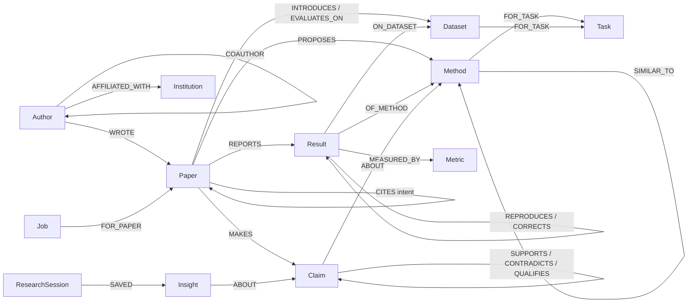

# Data model

Each workspace is one FalkorDB graph, `ws_<name>`. ChromaDB (`papers_<name>`) stores only text passages, keyed by `Paper.id`.
Questions, answers and insights also live in FalkorDB. There is no SQLite (rule 8 in `CLAUDE.md`).

## Node labels

| Label | In corpus | Key properties |
|---|---|---|
| Paper | 12 library + 4 stubs | title, year, published, in_library, abstract, keywords, file, first_author, added_at |
| Author | 13 | name |
| Institution | 7 | name |
| Venue | 4 | name, short |
| Method | 8 | name, aliases[], keys[] (normalised spellings), anchors[] (papers cited next to a mention), family |
| Dataset | 4 | name, aliases[], keys[], anchors[], language, splits[] |
| Task / Metric | 3 / 3 | name, aliases; metric has unit, higher_is_better |
| Result | 70 | value, split, origin (proposed, baseline_run, quoted, reproduced, corrected), setting, source, reported_as |
| Claim | 13 | text, type (comparative, causal, sota, efficiency, observational), section, scope[] for sota |
| Job | runtime | stage, status, claimed_by, attempts, history[], error |
| ResearchSession / Question / Insight | runtime | memory |

## Relationships

| Relationship | Meaning |
|---|---|
| `(Author)-[:WROTE {position, affiliation}]->(Paper)` | authorship, with the affiliation printed in that paper |
| `(Author)-[:AFFILIATED_WITH {first_year, last_year}]->(Institution)` | career history (Rahul Mehta moved in 2024) |
| `(Author)-[:COAUTHOR {papers, count}]->(Author)` | stored in both directions. Co-authorship has no direction, but FalkorDB algorithms (betweenness, WCC) follow edge direction, so each pair is written twice (23 pairs = 46 edges). |
| `(Paper)-[:PUBLISHED_IN]->(Venue)` | |
| `(Paper)-[:CITES {intent, ref_no, contexts}]->(Paper)` | **contexts** = the sentences where the citation appears |
| `(Paper)-[:PROPOSES]->(Method)`, `(Paper)-[:INTRODUCES]->(Dataset)` | contributions |
| `(Paper)-[:EVALUATES_ON]->(Dataset)`, `(Paper)-[:USES]->(Method)` | experiments, baselines, tools |
| `(Method)-[:EXTENDS]->(Method)` | derived: proposing paper cites the other with intent `extends` |
| `(Method)-[:SIMILAR_TO {score, basis}]->(Method)` | method sections embed close, but no lineage and no citation |
| `(Method)-[:FOR_TASK]->(Task)`, `(Dataset)-[:FOR_TASK]->(Task)` | which task a method solves and a dataset measures |
| `(Paper)-[:REPORTS]->(Result)-[:OF_METHOD\|ON_DATASET\|MEASURED_BY]->(…)` | one table cell |
| `(Result)-[:QUOTED_FROM]->(Paper)` | number copied from another paper |
| `(Result)-[:REPRODUCES {setting}]->(Result)` | reproductions: new run → original result |
| `(Paper)-[:CORRECTS]->(Paper)` | erratum: the correcting paper → the paper it corrects |
| `(Result)-[:CORRECTS]->(Result)` | corrected number: new value → the old value it replaces |
| `(Paper)-[:MAKES]->(Claim)` | findings |
| `(Claim)-[:ABOUT]->(Method)`, `(Claim)-[:ABOUT]->(Dataset)` | what a claim is about; always points from the Claim |
| `(Claim)-[:SUPPORTS\|CONTRADICTS\|QUALIFIES {basis}]->(Claim)` | newer → older |
| `(Claim)-[:CONFLICTS_WITH_RESULT {basis}]->(Result)` | claim beaten by a number |
| `(Job)-[:FOR_PAPER]->(Paper)` | pipeline state shared by agents |
| `(ResearchSession)-[:ASKED]->(Question)-[:ABOUT]->(…)`, `(ResearchSession)-[:SAVED]->(Insight)-[:ABOUT]->(…)`, `(ResearchSession)-[:READING_LIST]->(Paper)` | memory |



## Why Result is a node

A number has its own relationships: which method, which dataset, which metric, which paper reported it, which paper it was copied from, which result it reproduces or corrects. As a node it can be joined across papers (leaderboards), linked to corrections, and conflicted with claims. As a property on a paper, none of that is possible.

## Counts in the gold graph (ws_gold)

Measured on 2026-10-15 after `python -m app.graph.gold_loader --workspace gold`. Totals: **141 nodes, 606 relationships, 10 labels, 25 relationship types**.

```cypher
MATCH (n) RETURN labels(n)[0] AS label, count(*) AS n ORDER BY n DESC
```

| Label | Nodes |
|---|---:|
| Result | 70 |
| Paper | 16 |
| Author | 13 |
| Claim | 13 |
| Method | 8 |
| Institution | 7 |
| Dataset | 4 |
| Venue | 4 |
| Metric | 3 |
| Task | 3 |
| **Total** | **141** |

```cypher
MATCH (a)-[r]->(b) RETURN type(r) AS rel, labels(a)[0] AS src, labels(b)[0] AS dst, count(*) AS n ORDER BY rel
```

| Relationship | From | To | Edges |
|---|---|---|---:|
| ABOUT | Claim | Dataset | 14 |
| ABOUT | Claim | Method | 27 |
| AFFILIATED_WITH | Author | Institution | 14 |
| CITES | Paper | Paper | 49 |
| COAUTHOR | Author | Author | 46 |
| CONFLICTS_WITH_RESULT | Claim | Result | 2 |
| CONTRADICTS | Claim | Claim | 1 |
| CORRECTS | Paper | Paper | 1 |
| CORRECTS | Result | Result | 1 |
| EVALUATES_ON | Paper | Dataset | 17 |
| EXTENDS | Method | Method | 4 |
| FOR_TASK | Dataset | Task | 4 |
| FOR_TASK | Method | Task | 8 |
| INTRODUCES | Paper | Dataset | 4 |
| MAKES | Paper | Claim | 13 |
| MEASURED_BY | Result | Metric | 70 |
| OF_METHOD | Result | Method | 70 |
| ON_DATASET | Result | Dataset | 70 |
| PROPOSES | Paper | Method | 8 |
| PUBLISHED_IN | Paper | Venue | 12 |
| QUALIFIES | Claim | Claim | 3 |
| QUOTED_FROM | Result | Paper | 27 |
| REPORTS | Paper | Result | 70 |
| REPRODUCES | Result | Result | 6 |
| SIMILAR_TO | Method | Method | 1 |
| SUPPORTS | Claim | Claim | 5 |
| USES | Paper | Method | 25 |
| WROTE | Author | Paper | 34 |
| **Total** | | | **606** |

ABOUT, CORRECTS and FOR_TASK each appear twice because they connect two different pairs of labels, so the table has 28 rows for 25 relationship types.

## Runtime labels

`Job`, `ResearchSession`, `Question` and `Insight` are created by the pipeline agents and the research agent (Stage 4). They are empty in `ws_gold`.

- **Job**: one per uploaded PDF. Agents claim a job for their stage, do the work and hand it to the next stage.
- **ResearchSession**: one research session of a user.
- **Question**: a question asked in a session. The answer is stored on it as a JSON string property.
- **Insight**: a conclusion the user saved, linked to what it is about.
- **Lock**: a mutex in the graph for steps that rewrite the whole graph (ingest, reconcile, intent labels, sota check).
  - `name`: which lock (the pipeline uses `graph-write`).
  - `holder`: name of the agent holding it, or NULL when free.
  - `acquired_at`: timestamp (ms) when taken; a holder older than 10 minutes is presumed crashed and replaced.

Job properties:
- `stage`: where the job is: parse, extract, link, critique or done.
- `status`: ready (waiting for an agent), running (claimed), done, or failed (after 3 attempts).
- `claimed_by`: name of the agent working on it now (e.g. `extractor-2`), NULL when not running.
- `attempts`: tries at the current stage; reset to 0 when the job moves on.
- `history`: list of `agent:stage` entries, one per finished stage, so every hand-off is recorded.
- `error`: last error message (kept after a successful retry, so the board can show what went wrong).
- `paper`: id of the Paper the parser created for this PDF (also linked by `FOR_PAPER`).

## Indexes

`gold_loader` creates a range index on `id` for every label in the gold file (the 10 labels above), so `MATCH (n:Label {id: $id})` is an index lookup instead of a label scan. The runtime labels are not in the gold file, so the loader does not index them.
