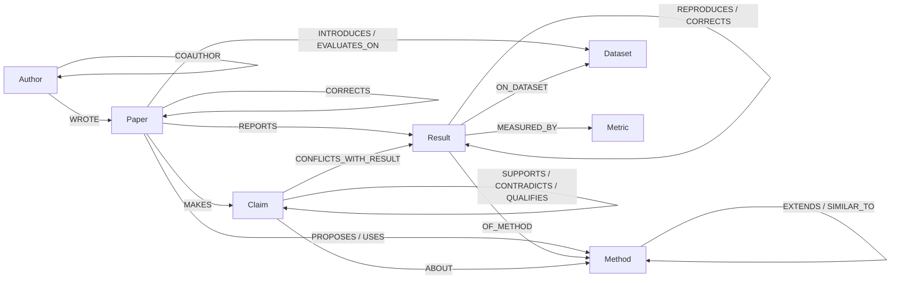
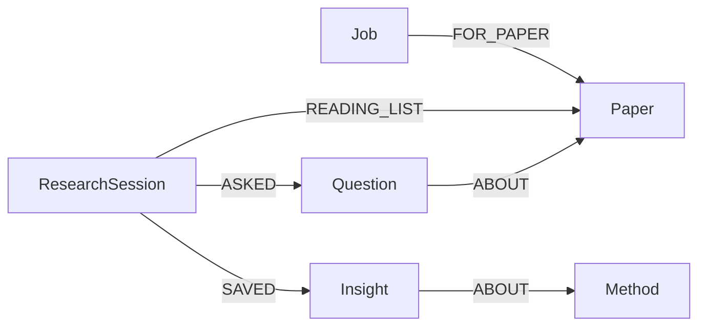

# Step 37: README, AI disclosure, final checks (then the video and the submission)

Save as `docs/prompts/step37.md` and tell Claude Code: "Do docs/prompts/step37.md".
Also download `step37-assets.zip` (the images) and unpack it first, as below.
Tested: the new `export_cypher.py` writes 67 queries and passes `--check`; backend `pytest -q` still passes.

## First, unpack the images (you, not Claude Code)

From the repo root (`C:\Users\POOJA\Desktop\graphmind-research`):

```powershell
# PowerShell
Expand-Archive "$env:USERPROFILE\Downloads\step37-assets.zip" -DestinationPath . -Force
```
```
:: cmd
tar -xf "%USERPROFILE%\Downloads\step37-assets.zip"
```

This adds:
- `docs/graphmind-architecture.png` and `.svg`, updated: the EXTRACT and UNDERSTAND boxes now say "graph rules, cue
  words" and "keyword rules (LLM only as fallback)", as the code does since Step 31.
- `docs/screenshots/library-map.png`, `ask.png` and `pipeline.png`.

## What the submission needs, and where it is

From the Graph Hacks rules page:

| Required | Where it is after this step |
|---|---|
| Public source-code repository | GitHub (you make it public at the end) |
| README with setup instructions and the graph data model | `README.md`: "Setup", "Run", "Graph data model" |
| The Cypher queries or graph algorithms the product depends on, documented | `docs/CYPHER.md`: all 67 named queries, including the PageRank, betweenness and WCC calls |
| Demo video of the working project | You record it (script below); the link goes into the README and the form |
| Live deployment, or complete local setup instructions | Local setup (it needs a local LLM) |
| Every track you enter, named | README top line and the form: Agents That Act on Connected Data; Agent Memory and Coordination |
| AI coding assistants disclosed (rule 11) | README "AI assistance" and `docs/ai-assistance/README.md` with every instruction file |

Two rules worth showing in the video:
- **Rule 3**: "if the product still works without FalkorDB, the graph is only decoration". Stopping FalkorDB shows the
  opposite.
- **Rule 12**: you must be able to explain the graph model, the queries, the architecture and the decisions.

## Why these changes

- **`docs/CYPHER.md` covers every query group, not just the agent's tools.**
  - Until now it documented the 34 queries in `analysis.py`. The product also depends on the citation facts
    (`enrich.FACT_Q`), the job claim, hand-off and lock (`memory.MEM_Q`) and the UI reads (`main.VIEW_Q`).
  - The coordination queries are the heart of the Agent Memory and Coordination track, so judges should see them.
  - The doc is still generated from the code, so it cannot drift: `--check` fails if someone edits a query without
    regenerating.
- **The README answers a judge's questions in order:**
  - what it does;
  - why it needs a graph (rule 3);
  - the architecture;
  - the data model (Mermaid diagrams, which GitHub draws, plus tables);
  - where the Cypher is;
  - how the agents map to the two tracks;
  - honest evaluation numbers;
  - setup;
  - limitations;
  - AI use.
- **The prompt files are moved, not deleted.**
  - Rule 11 asks for disclosure, and the files are in git history anyway, so deleting them would look like hiding.
  - `docs/ai-assistance/prompts/` says what they are, and each one doubles as a design log ("why it's built like
    this").
- **`requirements.txt` and `.env.example` are checked.** A judge's first action is `pip install -r requirements.txt`.
  A missing package (uvicorn was the one missing from your venv) is a broken first impression.
- **`.gitignore` and the secrets check.** The repo goes public, so `.env`, ChromaDB data and uploaded PDFs must not be
  in it.
- **`ontology.json` COAUTHOR text.** It still says "stored once". COAUTHOR has been stored in both directions since
  the betweenness fix, because betweenness follows edge direction.

## The prompt for Claude Code

Read this whole file before changing anything (step 4 moves it).

1. **Inventory first.** Report these and change nothing yet:
   - what is in `docs/` and `docs/prompts/`;
   - where `EVALUATION.md` is;
   - where the venv is (`backend\.venv` or `.venv`);
   - whether `backend/requirements.txt` and `.env.example` exist, and which variables `.env.example` lists;
   - what the current README says about building or loading workspaces (including `gold`);
   - what `.gitignore` contains.
2. **`backend/app/graph/export_cypher.py`.**
   - Replace it with the code below, then run `python -m app.graph.export_cypher` (expect `wrote ... (67 queries)`)
     and `python -m app.graph.export_cypher --check`.
   - If the count differs because a query dict in this repo differs, that is fine: report the number and use it in
     the README instead of 67.
3. **`ontology.json`.**
   - Set the `COAUTHOR` description to: `(Author)-[:COAUTHOR {papers, count}]->(Author), stored in both directions
     (FalkorDB's betweenness follows edge direction)`.
   - First check that `ingest.py` really writes both directions. If it does not, keep the text matching the code and
     tell me.
4. **Move the prompts.**
   - Run `git mv docs/prompts docs/ai-assistance/prompts` (this file goes with them).
   - Create `docs/ai-assistance/README.md` with the content below.
   - Search the repo for `docs/prompts` and update every reference.
5. **Requirements.**
   - Every third-party package imported under `backend/app` and `backend/tests` must be in `requirements.txt`.
     Compare with `pip freeze` in the venv, and add any that are missing, pinned the same way as the existing lines.
     Check `uvicorn[standard]` in particular.
   - `.env.example` must list every setting the code reads, with safe local defaults and no secrets:
     `FALKORDB_HOST`, `FALKORDB_PORT`, `OLLAMA_URL`, `CHROMA_PATH`, `UPLOAD_DIR`, `WORKERS_PER_STAGE`, and whatever
     `app/config.py` reads.
6. **`.gitignore`.**
   - It must ignore `.env`, `.venv/`, `venv/`, `__pycache__/`, `.pytest_cache/`, the ChromaDB folder (wherever
     `CHROMA_PATH` points, e.g. `backend/chroma_data/`), `backend/uploads/`, `frontend/node_modules/` and
     `frontend/dist/`.
   - `git ls-files` must not list `.env`, ChromaDB or upload files, or `node_modules`. If one is tracked, run
     `git rm --cached` on it and tell me.
7. **`README.md`.** Replace it with the content below, then make every line true for this repo:
   - Check every command against the module's argparse and the real files: venv location, `requirements.txt`,
     `.env.example`, the path to `EVALUATION.md`. Where the repo differs, fix the README. Never invent a flag.
   - If `docs/screenshots/*.png` or `docs/graphmind-architecture.png` is missing, tell me. Do not delete the image
     lines.
   - Compare the numbers in "How well it works" with `EVALUATION.md`. If they differ, use EVALUATION.md's.
   - Leave `DEMO_VIDEO_LINK` as it is; I'll fill it in after uploading.
   - If the old README has something important the new one lacks (for example how the `gold` workspace is loaded),
     add it in the right section.
8. **Final checks.** Report each one:
   - In `backend/`: `pytest -q` (expect 58 passed), and `python -m app.graph.export_cypher --check`.
   - In `frontend/`: `npm run build`.
   - `git status` shows only the intended changes.
   - `git grep -n -i -E "api_key|secret|password|token"` shows nothing sensitive.
   - `git log --all --oneline -- .env backend/.env` is empty (`.env` was never committed).
9. **Report.** In five lines, say what you changed and anything that needs my decision. Do not commit.

## Files

### backend/app/graph/export_cypher.py

````python
"""Write docs/CYPHER.md from the query dicts in the code, so the docs always show the Cypher that actually runs.

    python -m app.graph.export_cypher            # (re)write docs/CYPHER.md
    python -m app.graph.export_cypher --check    # exit 1 if docs/CYPHER.md is out of date

Four dicts hold every named query: the agent's tools (analysis.Q), the citation facts the Extractor agent checks
(enrich.FACT_Q), agent coordination and memory (memory.MEM_Q) and the UI's reads (api.main.VIEW_Q).
"""
import importlib
import re
import sys
import textwrap
from pathlib import Path

OUT = Path(__file__).resolve().parents[3] / "docs" / "CYPHER.md"   # graph -> app -> backend -> repo root

# (module, dict name, part title, one line on what the part is for)
PARTS = [
    ("app.graph.analysis", "Q", "Agent tools",
     "The research agent's tools and the analysis views. Every fact in an answer comes from one of these; "
     "the LLM never writes Cypher."),
    ("app.agent.enrich", "FACT_Q", "Citation facts",
     "What the graph can prove about why paper $a cites paper $b. The Extractor agent checks these before it "
     "falls back to cue words; each returns true or false."),
    ("app.agent.memory", "MEM_Q", "Agent coordination and memory",
     "Jobs the four pipeline agents hand to each other, the lock in the graph, research sessions and insights."),
    ("app.api.main", "VIEW_Q", "UI views",
     "Read-only queries behind the web UI's paper panel, map, leaderboard pickers and sessions."),
]

KEY = re.compile(r'^\s+"(\w+)":\s*"')               # a line that starts a query:   "name": """   or   "name": "
SECTION = re.compile(r"^\s+#\s*-{3,}\s*(.+)$")      # a section header comment:     # ---------- title
COMMENT = re.compile(r"^\s+#\s?(.*)$")              # any other comment line


def read_comments(source: Path, dict_name: str, queries: dict, default: str) -> tuple[dict, dict]:
    """Walk one source file. Returns {query: section title} and {query: comment lines just above it}."""
    start = re.compile(rf"^{dict_name}\b[^=]*=\s*\{{")   # Q = {   or   Q: dict[str, str] = {
    section, pending, sections, notes = default, [], {}, {}
    inside = False
    for line in source.read_text(encoding="utf-8").splitlines():
        if start.match(line):
            inside = True
            continue
        if not inside:
            continue
        if line.startswith("}"):
            break
        if m := SECTION.match(line):
            section, pending = m.group(1).strip(), []
        elif m := COMMENT.match(line):
            pending.append(m.group(1).strip())
        elif m := KEY.match(line):
            sections[m.group(1)], notes[m.group(1)] = section, pending
            pending = []
    missing = set(queries) - set(sections)
    if missing:
        raise SystemExit(f"could not find these queries in {source.name}: {sorted(missing)}")
    return sections, notes


def heading(title: str) -> str:
    return title[:1].upper() + title[1:]          # not .capitalize(): that would turn FalkorDB into falkordb


def anchor(title: str) -> str:
    return re.sub(r"[^a-z0-9 -]", "", title.lower()).replace(" ", "-")


def load_parts() -> list:
    parts = []
    for module_name, dict_name, title, about in PARTS:
        module = importlib.import_module(module_name)
        queries = getattr(module, dict_name)
        source = Path(module.__file__)
        sections, notes = read_comments(source, dict_name, queries, title)
        groups: dict[str, list[str]] = {}
        for name in queries:                      # dict order = order in the file
            groups.setdefault(sections[name], []).append(name)
        rel = source.resolve().relative_to(OUT.parents[1]).as_posix()
        parts.append({"title": title, "about": about, "source": rel, "dict": dict_name,
                      "queries": queries, "groups": groups, "notes": notes})
    return parts


def render() -> str:
    parts = load_parts()
    total = sum(len(p["queries"]) for p in parts)
    out = ["# Cypher queries", "",
           "Generated by `python -m app.graph.export_cypher` from the query dicts in the backend. Do not edit by hand.",
           "",
           f"{total} named, parameterised queries in four groups. The graph writes that build papers, authors, "
           "citations and results from a PDF are in `backend/app/graph/ingest.py`, next to the parsing code.",
           "", "## Contents", ""]
    for p in parts:
        out.append(f"- [{p['title']}](#{anchor(p['title'])}) ({len(p['queries'])}, `{p['source']}` `{p['dict']}`): "
                   f"{p['about']}")
    for p in parts:
        out += ["", f"## {p['title']}", "", f"From `{p['source']}` (`{p['dict']}`). {p['about']}"]
        many_sections = len(p["groups"]) > 1
        for title, names in p["groups"].items():
            if many_sections:
                out += ["", f"### {heading(title)}"]
            for name in names:
                cypher = textwrap.dedent(p["queries"][name]).strip()
                params = sorted(set(re.findall(r"\$(\w+)", cypher)))
                out += ["", f"#### {name}" if many_sections else f"### {name}", ""]
                if p["notes"].get(name):
                    out += [" ".join(p["notes"][name]), ""]
                out += [f"Parameters: {', '.join(f'`${x}`' for x in params) if params else 'none'}", "",
                        "```cypher", cypher, "```"]
    return "\n".join(out) + "\n"


def main() -> int:
    text = render()
    count = text.count("\n```cypher\n")
    if "--check" in sys.argv:
        current = OUT.read_text(encoding="utf-8") if OUT.exists() else ""
        if current != text:
            print(f"{OUT} is out of date: run python -m app.graph.export_cypher")
            return 1
        print(f"{OUT} is up to date ({count} queries)")
        return 0
    OUT.parent.mkdir(parents=True, exist_ok=True)
    OUT.write_text(text, encoding="utf-8", newline="\n")
    print(f"wrote {OUT} ({count} queries)")
    return 0


if __name__ == "__main__":
    sys.exit(main())
````

### README.md

````markdown
# GraphMind Research

Drop a folder of research papers in. Four agents read them and build a knowledge graph in FalkorDB: who cites whom
and why, which method extends which, every number from every results table, and what each paper claims. Then ask
how the papers relate, and get answers in which every sentence comes from a graph query you can open and check.

**Tracks:** Agents That Act on Connected Data · Agent Memory and Coordination
**Demo video:** DEMO_VIDEO_LINK
**Built for:** Graph Hacks (WeMakeDevs × FalkorDB), 15–18 October 2026


## What you can ask

| Question | What the graph does |
|---|---|
| How are GraphWalker-QA and Revisiting Graph Gains related? | Follows every path between the two papers: the citation and its intent, shared authors and datasets, method lineage, claims that clash, results one re-ran from the other |
| Is HopLens really state of the art? | Joins HopLens's "state of the art" claim to every earlier result on the same dataset, split and metric, and finds GraphFuse higher on two of them. It also finds two earlier papers HopLens should probably cite |
| What is the leaderboard on TriHop-Bench 4-hop? | One number per method. GraphFuse's 22.7 was corrected to 19.4 by an erratum, so 19.4 is the number that counts |
| Where does LiteGraphFuse come from? | Walks `EXTENDS` edges back to the original methods |
| Which claims contradict each other? | Claim pairs the graph picked (the newer paper cites the older, both are about the same method), judged by the local LLM |
| Which authors bridge the groups? | Betweenness centrality over co-authorship, computed inside FalkorDB |
| What did I save earlier? | Reads the session's Insight nodes back from the graph |

The same findings have their own pages in the web UI: Library, Ask, Compare papers, Leaderboards, Disagreements,
Citation check, Research gaps, People and Sessions.


## Why it needs a graph

FalkorDB is not a store behind a chat box here; every feature is a graph query.

- **Answers are graph queries.** The research agent picks named Cypher queries (its tools) for the question, turns
  each result row into a numbered fact, and writes the answer from those facts only. The LLM never writes Cypher,
  and an answer that names anything outside the facts is rejected.
- **Multi-hop by nature.** A state-of-the-art check goes Paper → Claim → its scope → Results on the same dataset, split
  and metric → other Papers, published earlier. A missing-citation check combines three path patterns (shared
  datasets, look-alike methods, stronger results). Lineage is a variable-length walk over `EXTENDS`.
- **Graph algorithms as tools.** PageRank over `CITES` (influential papers), betweenness over `COAUTHOR` (bridge
  authors), weakly connected components (isolated groups).
- **The graph is the agents' shared state.** The four pipeline agents never call each other: they claim `Job` nodes,
  write their results into the graph, and hand the job on. A `Lock` node guards the steps that rewrite the whole graph.
- **The graph is the memory.** Sessions, questions (with their full answers) and saved insights are nodes linked to
  the papers and methods they are about, so they survive restarts and can be recalled by topic.
- **One graph per workspace.** Each workspace is its own FalkorDB graph (`ws_<name>`), so users or teams keep
  separate libraries and memories.
- **No graph, no product.** Stop FalkorDB and every API route answers 503; the UI shows a banner and comes back by
  itself when FalkorDB returns.

## Architecture


**The graph decides, the LLM judges, the vector store explains.**

- *Build path:* every uploaded PDF passes four agents. **Parser** (rules, no LLM) creates papers, authors, citations
  with their sentences, and one `Result` per table cell, and indexes the text in ChromaDB. **Extractor** labels why
  each citation was made (graph rules first, cue words second) and has the LLM pick each paper's main claim from its
  own sentences. **Linker** merges different spellings of the same method and links look-alike methods
  (`SIMILAR_TO`, by embedding the method sections). **Critic** asks the LLM how claim pairs relate, but only for pairs
  the graph picked, and checks state-of-the-art claims against the numbers.
- *Ask path:* a LangGraph agent: understand → plan → run the graph queries → find the passage behind each fact in
  ChromaDB (only inside the papers the graph chose) → verify, with at most one more round → answer → remember.
- *Stack:* FalkorDB 6 (Docker), Python, FastAPI, LangGraph, ChromaDB, Ollama (llama3.2 and nomic-embed-text, both
  local), React with Vite, Tailwind and React Flow.

## Graph data model

The full schema, with every property, is in [`ontology.json`](ontology.json). The core:



Agent coordination and memory live in the same graph:



| Node | What it is |
|---|---|
| `Paper` | A paper. `in_library` is true when its PDF was uploaded, false for a stub created from someone's reference list |
| `Author`, `Institution`, `Venue` | People and where they publish; `COAUTHOR` is stored in both directions because betweenness follows edge direction |
| `Method`, `Dataset`, `Task`, `Metric` | Named things the papers talk about; `aliases` keeps every spelling, `anchors` the papers cited right next to a mention |
| `Result` | One number from one table cell: value, split, origin (proposed, baseline run, quoted, reproduced, corrected), setting |
| `Claim` | A paper's main finding, one sentence; state-of-the-art claims carry their scope so they can be checked against results |
| `Job`, `Lock` | Pipeline work items (stage, status, claimed_by, history) and the graph-wide mutex |
| `ResearchSession`, `Question`, `Insight` | Research memory: what was asked (with the full answer), and what the user decided to keep |

`CITES.intent` is one of: extends, compares_against, uses_dataset, uses_method, reproduces, supports, criticizes,
corrects, background.

## Cypher queries and graph algorithms

All 67 named queries are in [`docs/CYPHER.md`](docs/CYPHER.md), generated from the code
(`python -m app.graph.export_cypher`; `--check` fails if the file is out of date):

- **Agent tools** (`backend/app/graph/analysis.py`): paper-pair paths, lineage, leaderboards, claim conflicts,
  state-of-the-art check, missing and stale citations, research gaps, and the FalkorDB algorithms
  `algo.pageRank`, `algo.betweenness` and `algo.WCC`.
- **Citation facts** (`backend/app/agent/enrich.py`): what the graph can prove about why one paper cites another.
- **Agent coordination and memory** (`backend/app/agent/memory.py`): atomic job claim, hand-off, retries, the lock,
  sessions, insights, "what's new since".
- **UI views** (`backend/app/api/main.py`): the reads behind the web pages.

## The agents

**Pipeline agents (Agent Memory and Coordination).** Parser, Extractor, Linker and Critic run as separate threads and
coordinate only through FalkorDB:


- *Claim:* one write query finds a ready job for the agent's stage and marks it running. FalkorDB runs write queries
  one at a time per graph, so two agents can never claim the same job.
- *Waves:* a stage starts only when every paper has finished the stages before it, because citation intents and claim
  pairs depend on which papers exist.
- *Lock:* steps that rewrite the whole graph (ingest, merging names) take a `Lock` node first.
- *Failure:* a failed job goes back to ready and fails for good after three attempts; a job left running by a crashed
  process is put back when the agents next start. Each job keeps the history of which agent did which stage, which
  the UI shows live.

**Research agent (Agents That Act on Connected Data).** A LangGraph workflow. It recognises the question's intent and
the papers, methods and datasets it names; chooses a fixed plan of named graph queries for that intent; runs them;
attaches the supporting passage to each fact; checks whether anything the question needs is missing and runs more
queries if so (at most two rounds); and writes the answer from the facts. Unknown names get a clarifying question
instead of a guess. Every step is streamed to the UI with the Cypher it ran.

**Memory.** Each session's questions, answers and insights are stored as nodes linked `ABOUT` the papers and methods
they concern. The agent recalls them ("What did I save earlier about HopLens?"), and "What's new since" lists papers
added after a question that touch its topics.

## How well it works

Measured against a hand-built ground-truth graph (`ground_truth/gold_graph.json`) for the 12 papers in `corpus/`.
Details, method and what went wrong: [`EVALUATION.md`](EVALUATION.md).

| What | Result |
|---|---|
| Citations found | 49 / 49 |
| Results extracted from tables | 70 / 70 |
| `EXTENDS` and `SIMILAR_TO` between methods | 4 / 4 and 1 / 1 |
| Citation intent accuracy | 0.918 with graph rules and cue words (LLM alone: 0.735; cue words alone: 0.551) |
| Claims (main finding per paper) | precision 0.364, recall 0.615 |
| Four agents on all 12 PDFs | about 190 s on a laptop, same graph as the step-by-step build |

The weakest part is claim extraction and claim relations, where a small local LLM decides; the design keeps the LLM
away from anything the graph can decide by itself.

## Setup (local)

Live deployment is not practical (it needs a local LLM), so this is the complete local setup. Developed on Windows;
the same commands work on macOS and Linux with `/` paths and `source .venv/bin/activate`.

**Prerequisites:** Docker, Python 3.12 or newer, Node.js 22 or newer, [Ollama](https://ollama.com).

1. **FalkorDB** (tested with 6.0.1):
   ```
   docker run -d --name falkordb -p 6379:6379 -p 3000:3000 --restart unless-stopped falkordb/falkordb:latest
   ```
   Port 3000 is FalkorDB's own browser, if you want to look at the graph directly.
2. **Ollama models:**
   ```
   ollama pull llama3.2
   ollama pull nomic-embed-text
   ```
3. **Backend:**
   ```
   cd backend
   python -m venv .venv
   .venv\Scripts\activate
   pip install -r requirements.txt
   copy .env.example .env
   ```
   The defaults in `.env` point at FalkorDB on localhost:6379 and Ollama on localhost:11434.
4. **Frontend:**
   ```
   cd frontend
   npm install
   ```

## Run

Two terminals:

```
:: 1. API (in backend\, venv active)
python -m uvicorn app.api.main:app --port 8000

:: 2. UI (in frontend\)
npm run dev
```

Open http://localhost:5173, create a workspace (the + next to the workspace name), and drop the PDFs from
`corpus\pdf` onto the Library page. The pipeline board shows the four agents at work (about three minutes with
Ollama); then try the questions above on the Ask page.

Everything also runs from the command line (in `backend\`):

```
:: build a workspace step by step: parse (no LLM) and index passages, then enrich
python -m app.graph.ingest --workspace demo --index ..\corpus\pdf
python -m app.agent.enrich --workspace demo

:: or let the four agents do it
python -m app.agent.pipeline --workspace agents --workers 2 ..\corpus\pdf

:: ask, with the passage behind each fact
python -m app.agent.workflow --workspace demo --evidence "Is HopLens really state of the art?"

:: score a workspace against the ground truth
python -m app.eval_extraction --workspace demo

:: tests (need FalkorDB running) and the Cypher doc check
pytest -q
python -m app.graph.export_cypher --check
```

## Project layout

```
backend/
  app/graph/     pdf_parser.py (PDF -> text, references, tables), ingest.py (graph writes), analysis.py (agent tools),
                 client.py (one graph per workspace), export_cypher.py
  app/agent/     pipeline.py (four agents), enrich.py (intents, claims, links), memory.py (jobs, lock, sessions),
                 workflow.py (research agent), llm.py (Ollama calls with closed answer sets)
  app/docs/      docstore.py (ChromaDB passages)
  app/api/       main.py (FastAPI; server-sent events for the agent)
  tests/
frontend/src/    pages/ (one per screen), components/ (map, pipeline board, step timeline, answers)
corpus/          12 synthetic papers: pdf/ and their source_md/
ground_truth/    gold_graph.json, expected_answers.json
ontology.json    node labels, relationship types, closed vocabularies
docs/            CYPHER.md, architecture diagram, screenshots, ai-assistance/
```

## Data

The 12 papers in `corpus/` are synthetic: written for this project, with invented methods, datasets and authors, so
that the correct graph is known and the extraction can be measured. No real, paywalled or personal data is loaded.

## Limitations

- The PDF parser is tuned to the corpus layout (numbered references, results tables with a source column); real
  papers with other layouts will yield fewer results and citations.
- Claim extraction and claim relations depend on a small local LLM and are the least accurate part.
- Runs locally; there is no hosted demo and no user accounts (workspaces are separate graphs, not access control).

## AI assistance

AI coding assistants were used, as the rules allow: Claude (Anthropic) for design and the step-by-step instructions,
and Claude Code to apply them in this repository. What was done by whom, and every instruction file in order, is in
[`docs/ai-assistance/`](docs/ai-assistance/README.md).
````

### docs/ai-assistance/README.md

````markdown
# AI assistance

The Graph Hacks rules allow AI coding assistants when their use is disclosed (rule 11). This page says which
assistants were used, for what, and where to find every instruction they were given.

## Assistants used

- **Claude (Anthropic), in the Claude app.** Discussed the idea and the graph model; wrote the step-by-step
  instruction files, each with the full code and the reasoning behind it; tested that code against FalkorDB in its own
  sandbox before handing it over; generated the synthetic paper corpus and its ground-truth graph; drew the
  architecture diagram; drafted the README.
- **Claude Code.** Applied each instruction file to this repository on my machine, ran the tests and checks it asked
  for, explained what it changed, and made the commits I asked for.

## What I did

<!-- Edit this list so it says, in your own words, exactly what you did. -->

- Chose the problem (finding relationships between research papers, after first trying a company-knowledge agent on
  15 October) and the two tracks.
- Set the constraints the code had to follow: FalkorDB as the only database (no SQLite), no secrets in git, one step
  at a time, commit only after I had checked a step.
- Ran every step on my own machine (Windows, FalkorDB in Docker, Ollama), ran the measurements in `EVALUATION.md`, and
  reported failures and results back, which decided what was built or fixed next.
- Reviewed each step before committing it. I can explain the graph model, the queries, the agents and the technical
  decisions (rule 12).

## The instruction files

[`prompts/`](prompts/) holds the instruction files in the order they were used: `stepNN.md` is exactly what Claude Code
was given for step NN, and the commit after it is the result. Each file explains why the step is built the way it
is, so it doubles as a design log.

## AI inside the product

Separate from the coding assistance, the running product uses two local models through Ollama:

- **llama3.2** picks each paper's main claim from its own sentences, judges how claim pairs the graph selected relate,
  can label citation intents (off by default: graph rules and cue words measured better), and writes the final answer
  from the numbered facts.
- **nomic-embed-text** embeds passages for ChromaDB and method sections for `SIMILAR_TO`.

Neither model writes Cypher or decides anything the graph can decide by itself.
````

## After Claude Code: your part

### 1. Say what you did, in your own words

Open `docs/ai-assistance/README.md` and rewrite the "What I did" list so it is exactly true. Judges read this page
next to rule 13, so plain and specific is best. Then tell Claude Code "commit" (suggested message:
`Step 37: README, data model, all Cypher documented, AI-assistance disclosure`) and push.

### 2. Record the demo video (about 3½ minutes)

**Before recording:**
- Start FalkorDB, Ollama, uvicorn and `npm run dev`.
- Ask one question once, so llama3.2 is loaded. The first answer after a cold start takes 10 to 20 seconds longer.
- Keep the `demo` workspace for the questions. Have `corpus\pdf` open in File Explorer to drag from, and a terminal
  ready with `docker ps` to see the FalkorDB container's name.
- Turn on Do Not Disturb, set the browser zoom to 100%, and hide the bookmarks bar.
- Recording: OBS Studio (free), or the Snipping Tool's screen recorder on Windows 11 (Win+Shift+R). Edit and speed up
  in Clipchamp (built into Windows 11). Upload to YouTube as Unlisted, unless the form says otherwise.

| Time | Show | Say (roughly) |
|---|---|---|
| 0:00 | Library map of `demo` | "Twelve papers. Which ones disagree? Who re-ran whose results? Is the newest one really state of the art? GraphMind Research answers from a knowledge graph in FalkorDB, and shows its working." |
| 0:15 | New workspace `video`; drag in the 12 PDFs; the pipeline board fills (speed up 4–8× when editing) | "Four agents: Parser, Extractor, Linker, Critic. They never call each other. Each claims a Job node in FalkorDB, does its stage and hands it on, and a stage waits until every paper has finished the one before." |
| 0:50 | Back on `demo`: click **reproduces** in the legend, then **HopLens** | "Papers sit in year rows; every arrow is a citation, coloured by why it was made. The panel shows HopLens's claim, whom it cites and why, and its numbers." |
| 1:15 | Ask "Is HopLens really state of the art?"; steps tick; open **sota_check**; point at a highlighted passage | "The graph decides, the LLM judges, the vector store explains. Every fact comes from a named Cypher query: here it is. The local model only writes the sentence. ChromaDB shows the passage in the paper." |
| 2:05 | Compare papers (GraphWalker-QA vs Revisiting Graph Gains), then Leaderboards, TriHop-Bench 4-hop | "One paper re-ran the other: same author, a contradicting claim, four re-runs. And the leaderboard uses the erratum's corrected number, not the published one." |
| 2:30 | Save as insight → New session → "What did I save earlier?"; Sessions page | "Questions, answers and insights are nodes in the graph, linked to the papers they're about. They survive restarts, and each workspace is its own graph." |
| 2:55 | Terminal: `docker stop <name>`, the banner appears; `docker start <name>`, the page comes back | "Without FalkorDB there is no product: every route answers 503. Start it again and the app reconnects by itself." |
| 3:20 | README: architecture image and data model | "Agents That Act on Connected Data, and Agent Memory and Coordination. The code, every Cypher query and the setup are on GitHub." |

Optional, 5 seconds: FalkorDB's own browser at http://localhost:3000 with
`MATCH (p:Paper)-[c:CITES]->(q:Paper) RETURN p, c, q` on graph `ws_demo`. That shows the data really lives in
FalkorDB.

### 3. Submit

- [ ] Step 37 committed and pushed.
- [ ] **Fresh-clone test**, the best single check, because it is exactly what a judge does:
  - Clone the repo into a new folder and follow the README's Setup in a new terminal (new venv, `npm install`).
  - Start both servers and ask one question.
  - Fix anything that fails, then commit and push.
- [ ] "What I did" rewritten in your words.
- [ ] Video uploaded; its link replaces `DEMO_VIDEO_LINK` in the README; commit and push.
- [ ] `git log --all --oneline -- .env backend/.env` is empty. Then make the repo public (GitHub → Settings → General
  → Danger zone → Change visibility).
- [ ] Optional: add a LICENSE (MIT is common). Rule 15 says the IP is yours; a license says what others may do with
  it.
- [ ] Submission form:
  - repo URL;
  - video URL;
  - both track names written exactly;
  - the README's first paragraph as the description.
  
  Submit a few hours before **Sun 18 Oct, 11:59 PM IST**.
- [ ] Optional side prize: a blog post about the build.
- [ ] Rule 12 practice: explain each of these out loud once.
  - The data model (README diagram).
  - One query end to end: `sota_check` in `docs/CYPHER.md`.
  - How two agents can never take the same job (one write query; FalkorDB runs writes one at a time per graph).
  - Why stages run in waves.
  - Why rules come before the LLM (0.918 against 0.735).
  - What happens when FalkorDB is down.
